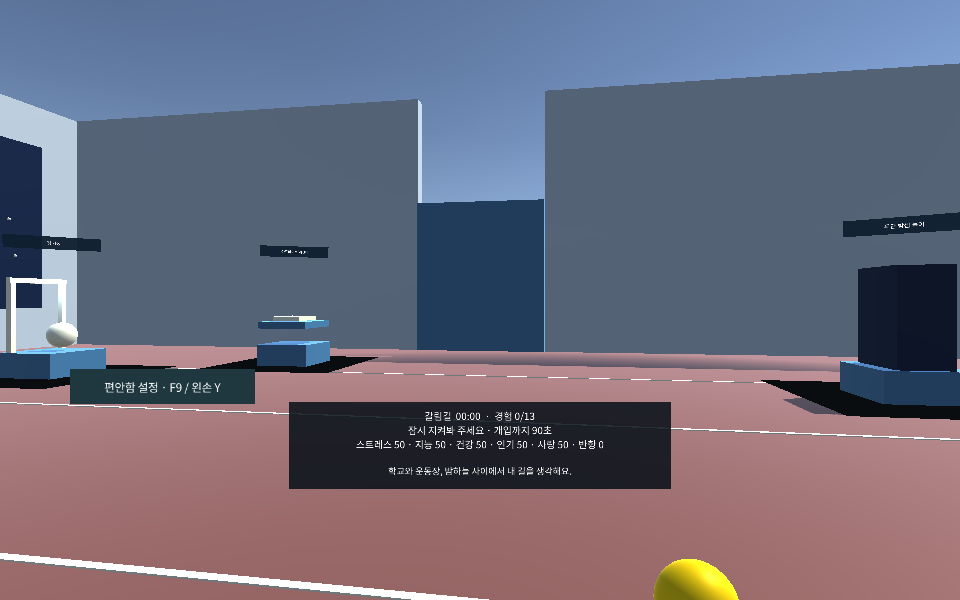
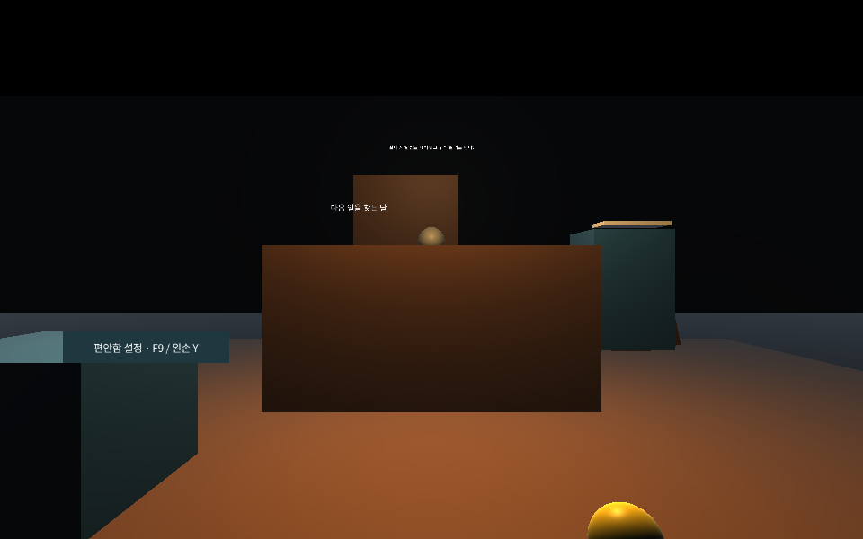

# 15단계 Quest 스탠드얼론 최적화

## 기준과 측정 범위

보유 기종은 아직 답변으로 확인되지 않았다. **Quest 2 / 72Hz를 임시 최저 기준**으로 사용한다. Quest 3/3S에서도 같은 설정으로 시작하며, 실제 보유 기종이 확인되면 90Hz 여부를 별도 측정한다. 현재 ADB에 연결된 기기는 0대다. 실기기가 없으므로 설치·실행·발열 후 프레임 유지·양안 화질은 미검증이다. APK 생성과 APK 구조 검사는 설치 성공의 증거로 표현하지 않는다.

아래 수치는 이 프로젝트의 예산이며 기기의 보장 성능이 아니다. Meta도 드로우콜/삼각형 수만으로 성능을 보장할 수 없으며 실제 프레임 측정을 요구한다. [Meta 성능 분석 지침](https://developers.meta.com/vr/documentation/unity/unity-perf/), [OpenXR Meta Quest 설정](https://developers.meta.com/vr/documentation/unity/unity-openxr-settings-quest/).

| 항목 | 프로젝트 목표 |
| --- | --- |
| 표시 주기 | 72Hz, 프레임당 13.89ms |
| CPU / GPU | 로딩 제외 정상 구간 각각 p95 ≤11.5ms를 목표로 여유 확보 |
| 삼각형 | 방 하나 ≤100,000, 로드된 씬 전체 ≤250,000 |
| 실제 드로우콜 | 렌더링 프레임당 ≤200 목표, 실기기 측정 필요 |
| 텍스처 | 콘텐츠 텍스처 ≤128MiB, XR eye buffer/컴포지터 메모리는 별도 |
| 전체 메모리 | 앱 사용량 ≤1.5GiB 목표, 실기기 확인 필요 |
| 조명 | 주 방향광 1개, 오브젝트당 추가광 1개, 추가광 그림자 없음 |

`QuestRuntime`은 설치된 Meta OpenXR provider가 세션을 초기화한 뒤 지원 주파수에 72Hz가 있으면 요청한다. 지원 목록·실제 적용 주파수는 기기에서 확인해야 한다. [주파수 설정 안내](https://developers.meta.com/vr/documentation/unity/unity-set-disp-freq/).

## 구현

- `QuestBuildSetup`: Android OpenXR 로더, Meta Quest Support + Meta XR + Touch/Touch Plus 컨트롤러 프로필, Single Pass Instanced 설정. Android에서 본편이 쓰지 않는 손 추적·모의 런타임·Space Warp 기능을 끈다. Standalone OpenXR 기능은 유지한다.
- Linear, Vulkan, IL2CPP, ARM64, 최소 API 29 / 타깃 API 34. API 34는 설치된 SDK로 재현 가능한 사이드로드 빌드 기준이며 스토어 배포 심사를 검증한 것이 아니다. 패키지 ID는 `com.fruitflyparenting.game`.
- Android 전용 **Quest 72Hz** 품질 레벨과 `URP-Quest.asset` / `URP-Quest_Renderer.asset`: MSAA 4x, render scale 1.0, HDR/후처리/불필요한 depth·opaque texture 끔, 그림자 거리 12m·1024 해상도·cascade 1·hard shadow, SRP Batcher 켬. 기존 PC 품질 레벨은 Android 빌드에서 제외하고 내용은 유지한다.
- `QuestSceneProcessor`는 Android 빌드 중 씬 사본에만 적용한다. 고정된 바닥·벽·가구 본체·복도 외벽을 정적 배칭 대상으로 지정한다. 리그·아이·문·회상 소품·엔딩 소품의 transform은 바꾸지 않는다. PC 원본 씬과 NavMesh도 유지한다.
- 물품별 실시간 조명은 Quest에서 끄고 기존 unlit 바닥 표시의 접근·첫 방문 밝기 변화와 소리를 유지한다. 프롤로그 맥박, 엔딩 결과별 색, 복도 중앙 조명은 보존한다. 서사에 따라 변하는 조명은 베이크하지 않았다. 낮은 메시 비용과 ambient 조명을 활용하며 이번 패스에서 라이트맵을 추가하지 않았다.
- 접근 바닥 메시를 실린더에서 2삼각형 quad로 변경했다. `FlyAgent`의 생존 객체 목록을 공유하고 거리 확인은 0.1초마다 수행한다. 제곱 거리 비교를 쓰고 접근/방문 상태가 바뀔 때만 머티리얼 데이터를 갱신한다. 이동·충돌·물품 진입 판정은 기존 주기를 유지한다.
- `ItemChoiceModel`은 기존부터 목적지를 고르는 사건에서만 실행한다. `ComplianceStateMachine.Tick`은 시간 만료와 작은 접촉 큐 처리이므로 매 프레임 유지한다. 확률·학습·순응 경계값·게임 시간은 변경하지 않는다.
- Android에서는 Development Build에서도 F8 키 처리 및 디버그 UI 생성 코드를 전처리 단계에서 제외한다. 씬에 붙은 DebugHud와 RoomCoordinateGizmos는 빌드 중 제거한다. PC 개발 HUD는 유지한다.
- Android ASTC 6×6·최대 1024 텍스처 정책을 준비했다. 현재 프로젝트의 Art에는 압축 대상 이미지 텍스처가 없으며 재질 색과 절차적 메시가 중심이다. 런타임 비네팅 텍스처와 동적 글꼴 atlas는 이 importer 정책의 대상이 아니다.
- 배경음은 Android Vorbis/quality 0.5/CompressedInMemory/22050Hz, 짧은 접근음은 ADPCM/DecompressOnLoad로 지정했다. PC import 설정은 유지한다.

## 지오메트리 전후 비교

원본 메시의 삼각형 및 머티리얼 제출 슬롯을 센다. **머티리얼 슬롯 수는 실제 GPU 드로우콜이 아니다.** 카메라 가시성, 그림자 패스, 배칭, UI, 동적으로 생성된 표시는 실제 수치를 바꾼다. 비활성 후속 방까지 포함한 씬 전체와 방 단위를 별도로 기록한다. [원본 감사 JSON](reports/step15-geometry.json).

| 대상 | 삼각형 전 → 후 | 머티리얼 슬롯 전 → 후 |
| --- | ---: | ---: |
| RoomShell 프리팹 | 192 → 192 | 16 → 16 |
| CorridorShell 프리팹 | 900 → 900 | 12 → 12 |
| 영유아 방 | 5,124 → 5,124 | 49 → 49 |
| 아동기 방 | 11,648 → 11,648 | 126 → 126 |
| 청소년기 방 | 21,940 → 21,940 | 122 → 122 |
| 청년기 방 | 5,004 → 5,004 | 91 → 91 |
| 중년기 독립 씬(리그 포함) | 9,848 → 9,848 | 42 → 42 |
| 전체 성장 경로를 포함한 영유아 씬 | 58,764 → 58,764 | 480 → 480 |

원본 가구가 이미 저폴리곤이므로 LOD 교체나 메시 축약은 하지 않았다. 24×22m 방 쉘과 9개 가구의 배치를 유지한다. 위 수치는 런타임 바닥 표시 변경을 포함하지 않는다. 실제 드로우콜 및 텍스처·전체 메모리 예산 충족은 아직 판정하지 않는다. 480은 후속 방이 모두 로드된 상태의 정적 슬롯 합계이며 화면 한 프레임의 드로우콜로 해석하지 않는다.

## 재현과 프로파일링

Unity 메뉴 `Fruit Fly Parenting/Setup 15 Quest Android`로 설정하고 `Build 15 Quest Release APK` 또는 `Build 15 Quest Profiling APK`로 빌드한다. Android 빌드는 한글 프로젝트 경로를 거부하므로 다음 스크립트는 독립 복사본과 임시 영문 드라이브 연결을 사용한다. Gradle의 prefab/CMake 단계도 한글 TEMP 경로에서 실패해 TEMP/TMP와 Gradle cache를 복사본 아래 영문 경로로 지정한다. 이 환경 변수는 빌드 프로세스에만 적용하며 시스템 설정은 바꾸지 않는다. 원본에 열린 에디터와 작업 내용은 유지한다.

```powershell
.\scripts\Build-Quest.ps1 -Test
.\scripts\Build-Quest.ps1 -Development
```

기본 출력은 `Builds/QuestProject/Builds/Step15/FruitFlyParenting.apk`, 개발용은 `FruitFlyParenting-profiling.apk`다. Development 버전은 같은 앱 ID이므로 릴리즈 위에 설치하면 앱 실행 파일을 교체한다. 설치는 기기를 지정한 뒤 수행한다.

```powershell
adb devices -l
adb -s DEVICE_SERIAL install -r PATH_TO_APK
adb -s DEVICE_SERIAL shell monkey -p com.fruitflyparenting.game -c android.intent.category.LAUNCHER 1
```

Development APK의 `QuestPerformanceCapture`는 앱 데이터 폴더 `files/quest-performance-UTC.csv`에 0.5초 간격으로 CPU/GPU 프레임타임, draw calls, triangles, 메모리, GC, 실제 표시 주파수를 기록한다. 프레임 수·13.89ms 초과 수·최악의 프레임 시간은 샘플 사이 모든 Update를 집계한다(0.1ms 오차 허용). 없는 카운터는 빈칸이며 GPU 0ms로 간주하지 않는다. `adb shell run-as com.fruitflyparenting.game ls files`로 파일명을 확인하고 Device Explorer 등으로 회수한다.

```powershell
python tools/quest/summarize_capture.py CAPTURE.csv --output Logs/quest-device-summary.json
```

방별 표의 p95는 0.5초 간격 샘플의 통계다. 전체 프레임의 정확한 p95나 CPU/GPU 병목 확정값으로 표현하지 않는다. Unity Profiler/Meta OVR Metrics를 함께 사용한다. 측정 절차:

1. 기종·OS·배터리·앱 빌드 해시·주파수를 기록한다. Deep Profile은 끈다.
2. 10분 워밍업 후 영유아·아동·청소년·청년·중년 각 방에서 60초씩 운전/물품 접근/사건 연출을 기록한다.
3. 복도 전환·자막·설정 비네팅·감전과 엔딩 갤러리의 최악 구간도 기록한다. 로딩 구간은 별도 표시한다.
4. GPU가 11.5ms를 넘으면 shadow distance/resolution, MSAA 2x, render scale, 고정 foveation을 순서대로 비교한다. CPU가 넘으면 Profiler의 scripts/render thread/GC를 구분하고 실제 높은 항목부터 줄인다.
5. 릴리즈 APK로 다시 설치하고 USB/Bluetooth 키보드 F8을 눌러도 HUD가 나타나지 않는지 확인한다. 개발용 측정 코드가 없는 빌드에서 같은 구간을 OVR Metrics로 재검증한다.

## 검증 기록

릴리즈와 프로파일링 APK를 `Builds/Step15/`에 복사했다. 릴리즈 약 **75.0MiB**, 개발용 약 **117.8MiB**다. APK Signature Scheme v2 검증에 통과했고 ARM64만 포함한다. 릴리즈에는 성능 캡처 타입이 없고 개발용에만 있다. 양쪽 모두 DebugHud·RoomCoordinateGizmos·커넥톰 타입이 없으며 BuildReport의 실험 자산 수는 0이다. APK 해시는 [릴리즈 검사](reports/step15-apk-release.json)와 [개발용 검사](reports/step15-apk-profiling.json)에 기록한다. 배포용 키를 설정하지 않은 로컬 사이드로드 빌드다.

Android/Meta XR 209 설정의 EditMode **253/253**, 독립 PC 환경의 기존 회귀 PlayMode **69/69**, 다섯 방을 순회하는 Quest 품질 GPU 검사 **1/1**, 성능 CSV 분석 도구 검사 **2/2**가 통과했다. GPU 검사는 PC의 단안 렌더링이며 Quest 실기기의 양안 화질·성능 측정을 대신하지 않는다.





실행 결과와 APK 검사는 [검증 JSON](reports/step15-validation.json)에 기록한다. 기존 사용자 Meta XR 패키지 209를 포함한 복사본에서 Android를 빌드한다. PC 회귀·GPU 캡처는 앞 단계와 같은 12단계 패키지 기준의 독립 폴더에서 수행하며, 사용자 Standalone Meta XR 설정의 MRUK 실행 문제를 해결했다고 주장하지 않는다.

실기기 미연결로 프레임타임·실제 드로우콜·CPU/GPU 병목·발열·F8 실기기 입력·설치 및 실행 확인은 남아 있다. 이 항목을 완료로 체크하지 않는다.
