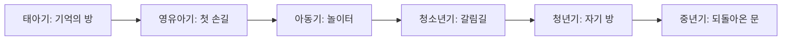

# 초파리 육아 VR 게임 기획 명세서

가제: 행복한 초파리 만들기
부제: 초파리 전기고문

> 이 문서는 사용자가 작성한 원본 기획 명세서를 구현 참조용으로 번호만 정리해 재구성한 것이다. 내용은 원본과 동일하며, 이 저장소의 모든 `prompts/*.md` 단계별 지시문은 이 문서를 단일 진실 소스(source of truth)로 참조한다. 기획 내용을 수정할 때는 이 파일을 먼저 고치고, 각 프롬프트 파일에서 수정 사항을 반영한다.

## 목차

1. [게임의 한 문장](#1-게임의-한-문장)
2. [전체 동선과 시간](#2-전체-동선과-시간)
3. [월드의 이야기](#3-월드의-이야기)
4. [플레이 규칙](#4-플레이-규칙)
5. [방별 상세 구성](#5-방별-상세-구성)
6. [엔딩 분기표](#6-엔딩-분기표)
7. [초파리 뇌지도 활용 설계](#7-초파리-뇌지도-활용-설계)
8. [VR 상호작용·연출 기준](#8-vr-상호작용연출-기준)
9. [구현 순서와 완료 기준](#9-구현-순서와-완료-기준)
10. [자료와 사실 관계](#10-자료와-사실-관계)

---

## 1. 게임의 한 문장

플레이어는 전기 휠체어에 탄 초파리의 보호자가 되어, 벽으로 둘러싸인 시대별 방에서 자유롭게 돌아다니는 아이를 지켜보거나 휠체어와 전기가 통하는 사랑의 매로 이동 방향을 바꾼다. 방은 시간이 지나면 다음 생애로 이동한다. 아이가 무엇을 경험하고, 얼마나 자주 통제받았는지가 훗날의 성향과 부모와의 관계로 돌아온다.

**장르/시점:** 1인용 VR 관찰·육성·분기 서사. 플레이어는 초파리보다 큰 보호자로서 전기 휠체어에 앉아 방과 복도를 직접 돌아다니며 아이를 관찰한다. 초파리는 거대한 초파리의 외형을 가지고 있으며 인간의 성장 단계와 생활 물품을 비유적으로 겪는다. 실제 초파리의 생애나 인간 발달을 재현하는 교육 게임으로 설명하지 않는다.

**목표 플레이 시간:** 첫 회차 45~60분. 영유아·아동·청소년·청년 방 각각 약 8~10분, 오프닝·복도·중년 엔딩 약 10분. 재회차에는 이미 본 장면을 건너뛸 수 있다.

**핵심 감정:** '좋은 결과를 만들어 주고 싶다'는 마음과 '내가 바라는 방향으로만 가게 해도 되는가'라는 고민. 모든 엔딩은 숫자 합산만이 아니라 플레이어가 했던 구체적인 행동을 되돌아본다.

---

## 2. 전체 동선과 시간

각 방 사이에는 12~16m 복도가 하나씩 있다. 방은 일렬로 배치되며 이전 방으로 돌아갈 수 없다. 이동 중 복도 벽에는 그 방에서 실제로 들른 물품 2~3개, 아이의 한마디, 부모의 개입 흔적이 사진처럼 나타난다. 복도 끝의 문은 다음 방에 도착할 때 열린다. 엔딩 뒤에는 전체 방이 축소된 형태의 회고 갤러리에서 회차 기록을 볼 수 있다.

### 2.1 시간 진행 규칙

방에 도착한 뒤 8분을 기준으로 창가의 빛이 이동하고 문이 서서히 가까워진다. 실제 방이나 VR 카메라를 강제로 전진시키지 않는다. 문이 열린 뒤에는 초파리가 먼저 출구 쪽으로 가고, 플레이어가 왼손 조종으로 휠체어를 몰아 출구 경계에 도착하면 짧은 페이드 후 복도로 전환한다. 복도에서도 휠체어를 직접 운전해 다음 방으로 들어간다. 7분 이전에는 문이 열리지 않고, 10분이 지나면 새로운 물품 효과가 멈추며 출구가 유일한 탐색 목표가 된다. 방의 분위기가 시간에 따라 변하는 연출은 유지하지만, 플레이어의 공간 이동은 왼손으로 직접 운전한 휠체어의 실제 위치를 따른다.

### 2.2 표준 방 규격

- 내측 24×22m, 높이 6m, 폭 3m 출입구 1개
- 실물 크기 기준 1.5~2m 높이 가구 8~10개, 가구 주변 최소 1.5m 통행 공간
- 플레이어의 휠체어 시작 지점은 방 중앙의 3×3m 회전 공간이며, 초파리는 방 내부 NavMesh에서 이동. 휠체어 폭은 약 0.8m로 설계하고 회전 지점에는 약 2m의 여유를 둠
- 복도는 폭 4m로 VR 시야와 동선이 막히지 않게 함
- 수치는 초기 50, 범위 0~100. 스트레스는 낮을수록, 나머지 네 수치는 높을수록 일반적으로 유리하지만 관계 수치와 엔딩은 서로 독립

### 2.3 제작용 좌표계

각 방의 남서쪽 안쪽 모서리를 (0,0), 동쪽을 x+, 북쪽을 z+로 둔다.

- 서쪽 입구 중심: (0, 11)
- 동쪽 출구 중심: (24, 11)
- 휠체어 시작점: (12, 9)

물품 슬롯 중심:

| 슬롯 | 중심 (x,z) m | 배치 원칙 |
|---|---|---|
| 북서 | (5, 17) | 빛이 들어오는 벽을 따라 배열 |
| 북중 | (12, 18) | 빛이 들어오는 벽을 따라 배열 |
| 북동 | (19, 17) | 빛이 들어오는 벽을 따라 배열 |
| 남서 | (5, 5) | 가구 사이에 돌아나올 틈 확보 |
| 남중 | (12, 4) | 가구 사이에 돌아나올 틈 확보 |
| 남동 | (19, 5) | 가구 사이에 돌아나올 틈 확보 |
| 서측 | (3, 11) | 출입구 중앙선에서 위아래 3m 이상 벗어난 상호작용 영역으로 조정 |
| 동측 | (21, 11) | 출입구 중앙선에서 위아래 3m 이상 벗어난 상호작용 영역으로 조정 |
| 북측 보조 | (8, 20) | 영유아기 태블릿 전용. 조기학습 화면과 분리하고 기존 가구 사이 1.5m 통로 확보 |

물품마다 최대 2.5×2.5m 발자국을 할당하고, 슬롯이 복도나 출입문과 겹치면 중심을 벽 쪽으로 최대 1m만 옮긴다.

### 2.4 방 외곽 통일 규칙 [맵 수정]

태아기 오프닝, 영유아기, 아동기, 청소년기, 청년기, 중년기 엔딩은 모두 하나의 큰 직사각형 방을 기본 틀로 쓴다. 성장 방의 외곽은 위의 24×22m 평면이며 서쪽 입구와 동쪽 출구가 서로 마주 본다. 방 내부의 교실·놀이터·학교·자취방·사무실·경기장·야외 장면은 바닥 재질, 벽면 그림, 조명, 천장 연출, 무대 배경과 소품으로 구분한다. 야외처럼 보이는 구역도 실제로는 같은 방 안이며 방 외곽의 벽과 출입구는 유지한다. 짧은 장식벽이나 가구는 둘 수 있지만 천장까지 닿는 내부 분리벽, 막힌 별도 방, 강제 분기 길은 만들지 않는다. 내부 NavMesh는 하나로 연결하고 물품 사이 이동 경로와 중앙 시야를 유지한다.

### 2.5 시기별 한 방 연출 [맵 수정]

- 영유아기: 가구와 모빌이 놓인 보육실 한 칸
- 아동기: 교실과 놀이터가 반반 보이는 한 칸
- 청소년기: 학교 벽화·운동장 그림·밤하늘 창문이 이어진 한 칸
- 청년기: 자취방 가구·면접 배경·경기장 조명이 한 칸 안에 함께 있는 구성
- 프롤로그와 엔딩: 같은 직사각형 외곽을 어둡게 가려 작은 공간처럼 보이게 함

복도는 오직 성장 방 사이에만 있으며 방 안에는 복도형 분리 통로를 만들지 않는다.

입구에서 휠체어 시작점까지 약 5m 길이의 통행로와 시작점에서 출구까지 이어지는 중앙 통로를 확보한다. 가구 주변의 1.5m 경로는 휠체어가 통과할 수 있도록 검사하고, 방향 전환 구역에는 약 2m 여유를 둔다. 방별 테마는 가구 모델·벽 재료·조명·배경음·물품 태그가 달라지는 방식으로 바꾸며 동일한 동선 규격을 재사용한다.

복도 구간: 진입 측 4m 회상 구간 / 중앙 6m 한 문장 내레이션 구간 / 출구 측 4m 다음 시기 실루엣 구간.

'서측/동측' 물품은 입출구 포털과 같은 평면에 두지 않고 북쪽 또는 남쪽 측면으로 빼서 초파리가 문을 통과하다가 우연히 발동하지 않게 한다.

---

## 3. 월드의 이야기

플레이어에게 이름 없는 작은 알이 맡겨진다. 누가 이 아이를 맡겼는지 설명하지 않는다. 첫 방의 벽에는 '다음 방까지 함께 있어 주세요'라는 문장만 쓰여 있다. 보호자가 있는 동안 아이는 가구를 만지고 실패하고 다시 걷는다. 아이는 말할 수 있게 되면서 자신이 좋아한 물건을 기억한다. 복도는 부모의 기록장이고, 뒤로 갈수록 아이의 문장과 방의 장식이 부모의 취향에서 아이의 취향으로 바뀐다.

오프닝에서는 손이 닿지 않는 유리 너머 알의 그림자만 보인다. 플레이어가 아무것도 못 한 상태에서 알이 스스로 깨어나는 장면으로 시작한다. 첫 방에서는 아이가 플레이어를 따라오고, 두 번째 방에서는 관심 있는 물품을 고르며, 세 번째 방에서는 통제에 반응하거나 스스로 반박한다. 청년기 방에서는 플레이어가 손을 뻗어도 아이가 그 행동을 받아들일지 선택한다. 마지막 방은 아이가 꾸민 공간이다. 플레이어의 목표는 '최고 성적'이 아니라 자신이 키운 아이와 맺은 관계의 결말을 보는 것이다.

---

## 4. 플레이 규칙

### 4.1 상태값과 행동 로그

| 표시 수치 | 의미 | 영향을 주는 것 |
|---|---|---|
| 스트레스 S | 피로, 압박과 회피의 축적 | 탐색 변동성, 막대 개입 반응, 엔딩 |
| 지능 I | 호기심과 학습 경험 | 학업·연구·창작 선택, 청년 직업 연출 |
| 체력 H | 놀이와 회복의 경험 | 활동 선택, 도전 지속성 |
| 인기 P | 친구와 사회적 연결 | 동료 관계, 외적 성공의 한 경로 |
| 사랑 L | 안정감과 부모와의 애착 | 신뢰·돌봄·재회, 히든 의상/엔딩 |
| 반항 R | 보호자의 통제에 맞서려는 성향 | 강제 유도에 대한 반응, 청소년기 종료 이벤트 |

**별도 비공개 로그:** 개입횟수, 최근 60초 개입횟수, 개입강도, 자율방문수, 같은 물품 재방문수, 부모의 마지막 개입 이후 거리, 물품별 접근·회피 경험, 방별 선택 장면, 부모와 아이의 신뢰 T(0~100, 초기 50).

T는 L과 다르다. 친구나 연인에게 받은 사랑이 높더라도 부모를 신뢰하지 않을 수 있다. T는 숨기지 않고 방 종료 때 '가까워짐/멀어짐' 같은 말과 아이의 행동으로 드러낸다.

**16단계 도달 가능성 보완(2026-11-25):** 아동기 가족 식탁, 청소년기 부모와 대화 의자, 청년기 부모에게 쓰는 편지를 **자율적으로 처음 방문**하면 각각 T +8을 적용한다. 강요·순응 방문이나 직전 6초 내 개입이 있는 방문, 재방문, 물품 효과 종료 후 방문에는 적용하지 않는다. 물품별 회차당 1회이며 `GameBalanceConfig.autonomousParentTrustGain`과 `autonomousParentTrustItems`로 관리한다. 기존 초기 T=50과 네 성장 방의 관찰 보상 최대 +16만으로는 히든 엔딩의 T≥70을 달성할 수 없었으므로, 엔딩 문턱과 기존 개입 비용을 유지하면서 실제 부모와의 관계 회복 경험을 추가한다. L 보상과는 별개다.

### 4.2 초파리 자율 이동

- 영유아기 첫 2분은 가구 선호 없이 안전한 NavMesh 점을 무작위로 뽑아 걸어간다.
- 벽과 가구에 충돌하지 않으며, 목적지까지 직선 경로가 막히면 경로를 재계산한다.
- 2분 이후에도 방당 최소 35% 확률로 랜덤 탐색 목표를 고른다.
- 같은 물품을 연속 두 번 선택할 수 없고 한 물품에 30초 이상 머물면 다른 지점으로 이동한다.
- 각 방의 시간은 부모가 물품을 모두 방문시키지 못해도 진행된다.
- 초파리가 물품의 상호작용 영역(반경 약 1.2m)에 들어가 2초 머물면 방당 최초 1회 효과가 적용된다. 같은 물품 재방문은 대사·애니메이션만 바뀌며 수치 보상은 반복되지 않는다.
- 2026-11-25 사용자 요청으로 방 입장 후 90초 도구 대기를 제거했다. 모든 성장 방에서 입장 직후 휠체어와 봉을 사용할 수 있다. 장면 전환·특수 연출 중의 입력 잠금은 유지한다.

### 4.3 전기 휠체어와 사랑의 매의 방향 유도

플레이어는 게임 시작부터 전기 휠체어에 앉아 있다. 왼손 컨트롤러의 스틱으로 전진·후진·회전을 조작한다. 오른손에는 검은 경광봉 모양의 사랑의 매를 기본 장착한다. 사랑의 매는 별도 전원 버튼이나 약한 모드 없이 항상 전기가 통한다. 오른손으로 봉 끝을 초파리에게 대면 짧은 만화적 감전 연출과 함께 봉을 댄 방향의 반대로 강하게 밀린다. 기존의 '버튼을 누르지 않은 약한 봉 밀기'는 없어지고 그 역할을 휠체어가 맡는다.

휠체어를 천천히 몰아 앞쪽 범퍼로 초파리에 닿으면 초파리가 휠체어 진행 방향으로 약하게 밀린다. 밀림 거리와 반응은 종전의 전기 없는 사랑의 매 1회와 같은 수준이다. 휠체어 접촉에는 전기 연출이 없으며, 플레이어의 이동 조작과 초파리 밀기가 같은 조작에서 자연스럽게 이어진다. 휠체어가 정지해 있거나 초파리와 접촉하지 않으면 밀기 이벤트가 발생하지 않는다. 접촉한 뒤 다음 밀기는 최소 1초 간격으로만 판정한다. 범퍼가 벽·가구와 초파리 사이에 끼이게 하지 않고 충돌 시 안전한 NavMesh 지점으로 초파리의 이동 방향을 조정한다.

초파리가 물품과 상호작용 중일 때 휠체어로 약하게 밀거나 오른손의 사랑의 매로 강하게 밀어 거리를 벌릴 수 있다. 아이는 이후 자율적으로 같은 물품에 돌아갈 수도 있다. 같은 물품에서 전기 봉으로 반복해서 밀리면 그 물품에 대한 반감이 학습되지만, 플레이어가 같은 방향으로 계속 밀면 4.6의 순응 규칙에 따라 결국 해당 방향으로 움직인다.

**개입 스트레스:** 휠체어의 유효한 약한 밀기와 사랑의 매의 유효한 전기 접촉을 모두 1회 개입으로 센다. 1회 기본 증가량은 +0.4이고, 직전 60초 개입이 n회면 증가량은 `min(3.0, 0.4 + 0.25×max(0,n-2))`이다. 전기 봉의 각 접촉에는 4.5의 S +2가 추가된다. 5초 미만 간격의 반복 밀기는 신뢰 T -1이다. 초파리를 밀지 않고 자율 방문을 60초 지켜보면 T +1(방당 최대 +4)을 적용한다. 연속 4회 밀면 초파리가 잠시 원래 목표로 돌아가려 하지만, 동일 방향 개입이 4.6의 임계점에 도달하면 버티기를 끝내고 순응한다.

**학습 이벤트:** 물품에 다가가기 전 6초 안에 개입이 있었고 아이가 실제로 방향을 바꿨을 때 `(방, 물품 태그, 접근 방향, 개입 횟수, 스트레스, 결과)`를 저장한다.

- '물품 앞에서 저지를 당함' → 회피·신뢰 학습에 사용
- '물품 방문 후 즐거움/피로' → 선호 학습에 사용
- 방을 넘길 때 물품 이름을 그대로 재사용하지 않고 태그(놀이, 공부, 휴식, 운동, 관계, 성과, 소비, 창작)로 일반화한다. 완전 접근 금지는 하지 않는다.

**선택 확률(초안):** `softmax(물품 기본 매력 + 태그 선호 - 회피 기억 + 상태 필요 + 소량 난수)`

난수 탐색 비율(하한): 영유아 0.65 → 아동 0.55 → 청소년 0.45 → 청년 0.35. 강한 편향이 있어도 무작위 후보가 남아 행동이 결정적으로 고정되지 않는다. 개발 중에는 현재 목적지·이유·난수 시드를 화면에 표시하는 디버그 패널을 사용한다.

### 4.4 수치 변화와 공정성

- 아래 각 방 표의 수치는 예시 밸런스 값. S-는 스트레스 감소.
- 한 방문에서 최대 변화량을 각 수치 ±12로 제한(일반 물품). ★ 물품은 ±25까지 허용(4.5 참조).
- 방별 마지막 90초에는 자율적인 휴식 물품의 선택 가능성을 높임.
- 높은 지능·체력·인기가 곧 높은 스트레스라는 단순 공식은 쓰지 않음. 성취형 물품은 강한 보상과 압박을 함께, 회복형 물품도 의미 있는 성장/관계 효과를 줌.
- 한 회차에 스트레스를 크게 낮출 방법을 방마다 최소 2개 둔다.

### 4.5 반항 수치 R의 적용 규칙 [추가]

반항 R은 화면에 표시하는 0~100 수치, 초기값 0. 방을 넘어가도 누적되며 100을 넘는 증가량은 버린다.

- 표에 적힌 반항 물품의 R 증가(+12/+15/+18/+20 등)는 **처음 방문했을 때만** 적용. 재방문·연출 재시청으로 반복 획득하지 않음.
- 이 수치는 플레이어가 통제한 경험과 초파리 스스로 선택한 불량행동을 구분하여 행동 기록에 저장.

**강제 유도 판정:** 지능 I 또는 체력 H가 5 이상 오르는 물품을 초파리가 방문하기 전 10초 안에 휠체어 범퍼나 사랑의 매로 그 물품 쪽으로 밀어 실제로 입장했을 때 '강제 훈련' 1회로 센다.

- 휠체어의 약한 밀기로 유도: 기본 물품 효과와 별도로 R +2, S +1
- 사랑의 매(전기 봉)로 유도: R +5, S +3
- 10초 동안 여러 번 밀어도 방문당 추가 효과는 1회만 적용. 두 방식이 섞였으면 전기 봉의 효과만 적용.
- 전기 봉 접촉 자체에는 기존 개입 스트레스 공식(4.3)에 더해 S +2를 즉시 적용 (물품 도착 전부터 스트레스 누적 가능). 휠체어의 유효 접촉과 전기 봉 접촉은 별개 이벤트로 기록한다.

**반복 훈련 판정:** 같은 방에서 I 또는 H가 5 이상 오르는 물품을 3개 이상 방문하면, 세 번째부터는 방문마다 R +4, S +3 추가.

- 해당 방문이 강제 훈련이기도 했다면 강제 훈련 효과와 반복 훈련 효과를 모두 적용.
- 한 방에서 반복 훈련 추가 효과는 최대 3회까지만 적용. R/S 누적값은 다음 방까지 유지.
- 같은 물품 반복 접촉이 아니라 서로 다른 성취 물품을 연이어 경험한 경우에 적용(영유아 조기학습, 아동 시험장 등 성취 몰아주기 경로 포함).

**회복과 행동:** 한 방에서 도구를 쓰지 않고 60초 동안 자율 선택을 지켜보면 R -2 (방당 최대 -8).

- 물품 자체의 S/I/H/P/L 효과와 R 증감은 별도로 계산.
- R이 높을수록 청소년기 반항·비행 물품 탐색 확률에 가중치를 더하지만 강제 선택은 아님.
- R≥35: 관련 대사 증가. R≥60: 청소년기 종료 특별 이벤트 확정.
- 일반 물품 기본 효과 한도: 각 수치 ±12. ★ 물품 기본 효과 한도: 각 수치 ±25.
- 강제·반복 훈련 추가 효과는 물품 기본 효과와 별개. 적용 후 최종 수치는 모두 0~100으로 clamp.

### 4.6 지속적인 휠체어·사랑의 매 사용과 방향 순응 [추가]

초파리는 처음에 원하는 물품으로 되돌아가거나 높은 R에 따라 더 오래 버틸 수 있다. 그렇더라도 플레이어가 휠체어나 전기 봉으로 같은 방향으로 계속 밀면 끝내 그 방향을 따라간다. 물품에 생긴 반감은 자율 재방문 확률을 낮추는 기억일 뿐, 플레이어의 지속적인 휠체어·봉 유도를 영구 무효화하지 않는다.

**판정 (누적 점수):**
- 최근 30초 동안 같은 쪽으로 민 유효 접촉을 누적. 휠체어의 약한 밀기 = 1점, 사랑의 매(전기 봉) = 2점.
- 최소 1초 간격의 접촉만 카운트. 방향이 반대가 되거나 10초 동안 추가 접촉이 없으면 누적 초기화.
- R < 70: 6점에서 '버티기' 종료 → 순응 상태 진입. R ≥ 70: 8점에서 종료. R=100이어도 8점 누적되면 반드시 순응.
- 기존 4.3의 "연속 4회 후 12초 회피" 반응은 이 임계점 도달 시 즉시 종료됨.

**순응 상태 (8초 유지):**
- 초파리는 플레이어가 미는 방향의 안전한 NavMesh 지점으로 이동.
- 같은 방향으로 접촉이 이어지면 8초 타이머 갱신.
- 벽/가구에 막히면 해당 방향에서 가장 가까운 통행 가능 지점으로 이동.
- 상호작용 영역 도착 후 2초 머물면 1회 물품 효과 적용 + 순응 상태 해제. "강요당한 방문" 기록 남김.
- 순응 종료 후 도구 사용을 멈추면 자율 탐색 재개 (영구적 선호 고정은 아님).

**대가:**
- 임계점 도달 순간: S +4, R +6 (1회)
- 같은 순응 상태 중 추가 유효 접촉마다: S +1, R +2
- 이 값은 4.3 기본 스트레스 공식, 4.5 전기 봉/강제훈련 효과에 **추가**로 적용. 모든 수치 0~100 clamp.
- 순응을 여러 번 유발해도 물품 기본 효과는 방당 최초 방문 1회만 적용.

---

## 5. 방별 상세 구성

평면 설명에서 입구는 서쪽, 출구는 동쪽이다. 플레이어 휠체어의 방별 시작점은 중심에서 남쪽으로 2m 떨어진 곳이다. 북쪽/남쪽으로 각각 네 개 내외 물품을 배치하고, 시선이 출구를 가리지 않게 중앙 통로를 비워 둔다. 가구는 1회 효과를 가진 선택 지점이며 모든 지점이 엔딩 조건으로 필요한 것은 아니다.

### 5.1 프롤로그 — 태아기: 기억의 방 (1~2분)

검은 공간에 작은 알, 심장 박동 같은 조명, 방의 윤곽이 하나씩 나타난다. 플레이어는 고개만 움직일 수 있다. 컷신이 끝나면 전기 휠체어에 앉아 있는 플레이어의 왼손 조종부와 오른손의 기본 전기 사랑의 매가 보인다. 영유아기 방에 도착한 뒤 왼손 이동 조작이 활성화된다. 자막: '초파리를 행복하게 만들어주세요.' 알이 스스로 부화한다. **이 시기에는 수치 변화와 개입이 없다.**

### 5.2 영유아기 — 첫 손길 (8~10분)

**시각:** 오후 햇살, 커다란 천장 모빌, 낮은 쿠션 벽. 캐릭터는 포대기에 싸여 쪽쪽이를 물고 바닥 가까이 통통 뛰어다닌다. 초파리가 자유롭게 이동하며 도구를 선택하고 플레이어는 해당 행동을 제어할 수 있다.

| 위치/물품 | 태그 | 효과 S/I/H/P/L | 서사 장면 |
|---|---|---|---|
| 북서: 알파벳 그림책 | 공부 | +3/+8/0/0/+2 | 그림을 뒤집어 읽고 보호자를 찾음 |
| 북중: 감각 블록 | 놀이·창작 | 0/+5/+2/0/+3 | 탑을 무너뜨리고 다시 쌓음 |
| 북동: 조기학습 화면 | 성과·공부 | +9/+11/-2/0/-2 | 화면 빛을 따라가며 눈을 비빔 |
| 남서: 푹신한 포옹 의자 | 휴식·관계 | -7/0/+3/0/+8 | 손을 내밀고 잠듦 |
| 남중: 친구 곁 공놀이 | 관계·운동 | -2/+1/+5/+5/+2 | 처음으로 다른 아이와 공을 나눔 |
| 남동: 달콤한 간식 상자 | 소비·휴식 | -3/0/-3/+1/+1 | 바로 웃지만 금세 배가 아픔 |
| 동측: 혼자 기어가기 길 | 운동 | +2/+2/+8/0/+2 | 끝에서 뒤돌아보며 웃음 |
| 서측: 작은 침대 | 휴식 | -6/0/+5/0/+3 | 잠깐 쉬고 새로운 지점을 탐색 |
| 북측 보조: 유튜브 태블릿 | 소비·놀이 | +8/-6/-7/-4/-5 | 자동재생 영상에 빠져 다른 놀이를 놓치고, 화면을 떠날 때 보채는 연출 |

**복도 1:** 벽에 첫 손자국과 방문 물품 사진. 어떤 물품을 피하게 했는지 아이의 걸음이 잠깐 망설이는 연출로 반영한다.

태블릿을 방문했다면 복도 벽에 영상의 잔상이 잠깐 비치고, 아동기 오락기와 같은 소비·놀이 태그의 선호 학습 기록에 반영한다. 태블릿을 재방문해도 수치는 다시 변하지 않는다. 이 효과는 게임 속 선택의 대가이며 실제 영유아 발달에 대한 수치적 주장으로 제시하지 않는다.

### 5.3 아동기 — 놀이터와 첫 약속 (8~10분)

**시각:** 하나의 커다란 사각형 방을 왼쪽 교실과 오른쪽 놀이터처럼 꾸민다. 캐릭터는 프로펠러 모자, 노란 반팔티, 파란 반바지. 중앙에는 두 갈래 길이나 실제 칸막이 벽을 두지 않고 바닥 재질과 색, 낮은 소품으로만 두 영역의 경계를 암시한다. 초파리는 방 전체를 어느 방향으로든 자유롭게 가로지를 수 있다.

**사건:** 친구가 만든 작은 종이 비행기가 찢어진다. 아이가 사과하고 함께 고칠지, 혼자 다른 놀이를 할지는 방문 경험과 T에 따라 다르게 연출한다.

| 위치/물품 | 태그 | 효과 S/I/H/P/L | 서사 장면 |
|---|---|---|---|
| 북서: 경시대회 책상 | 성과·공부 | +10/+12/-2/+2/0 | 상장과 지친 표정이 함께 남음 |
| 북중: 만들기 책상 | 창작·공부 | +1/+7/+1/+2/+3 | 실패한 비행기를 고침 |
| 북동: 축구 골대 | 운동·관계 | +1/0/+10/+5/+2 | 패스를 받을지 드리블할지 결정 |
| 남서: 도서관 쿠션 | 공부·휴식 | -3/+6/0/0/+1 | 스스로 고른 책을 읽음 |
| 남중: 친구의 생일상 | 관계 | -2/+1/0/+9/+5 | 친구 이름을 기억함 |
| 남동: 오락기 | 놀이·소비 | -5/+1/-2/+3/+1 | 웃으며 게임 후 잠시 쉬어 감 |
| 동측: 동네 산책길 | 운동·휴식 | -6/+1/+7/0/+2 | 목적 없이 주변을 돌아봄 |
| 서측: 가족 식탁 | 관계·휴식 | -5/0/+2/0/+8 | 부모와 첫 약속을 나눔 |

**배치 보충 [맵 수정]:** x=0~12m 쪽은 교실풍 바닥과 책장 벽화, x=12~24m 쪽은 놀이터풍 바닥과 하늘 그림·조명으로 꾸민다. 기존 물품 위치를 유지하며 만들기 책상과 친구 생일상은 경계 가까이에 둔다. 교실과 놀이터 사이는 색이 이어지는 바닥선뿐이고, 초파리가 통과할 수 있는 단일 개방 공간이다.

| 위치/물품(★ 극단) | 태그 | 효과 S/I/H/P/L | 서사 장면 |
|---|---|---|---|
| 북상1: 전국 영재 선발 시험장 ★ | 성과·공부 | +20/+23/-9/+7/-7 | 큰 상을 받지만 친구의 축하를 놓침. T -4 |
| 북상2: 어린이 스타 촬영장 ★ | 성과·관계 | +17/+2/-13/+22/-8 | 팬에게 둘러싸이고 집에서는 쓰러져 잠듦. T -4 |
| 남하1: 숙제 찢기와 비밀 아지트 ★ | 반항·놀이 | -16/-11/+4/+8/-7 | 스스로 정한 놀이 규칙에 해방감을 느낌. R +15, T -5 |
| 남하2: 몰래 밤새는 게임방 ★ | 반항·소비 | -18/-9/-17/+11/-5 | 친구들과 웃지만 다음 날 약속을 지키지 못함. R +12, T -4 |

극단적 물품에서는 아이가 방문 전에 망설이는 2초 연출을 넣고 보호자가 다가가도 마지막 접근은 자율 이동으로 확정한다. 비행기 사건은 `만들기 책상` 또는 `친구의 생일상`을 방문했다면 사과와 수리, `비밀 아지트`를 방문하고 T<40이면 사과를 미루는 장면으로 연결한다. 그 밖에는 아이가 다음 날 친구와 다시 이야기한다.

**복도 2:** 종이 비행기의 상태와 보호자가 끊은 행동에 관한 짧은 대사. 청소년기에는 이 약속을 기억하거나 잊는다.

### 5.4 청소년기 — 갈림길 (8~10분)

**시각:** 학교 복도·운동장·밤하늘 창문이 한 방에 겹친다. 기본 의상은 교복.

**히든 의상 조건:** 영유아·아동기 종료 시점 모두 S≥70이거나, 두 방 평균 S≥75이면 검은 반팔티와 녹색 바지를 입고 등장한다. 옷은 비행과 정체성의 진단이 아니라 압박이 쌓인 회차를 보여 주는 선택적 아트 연출이다. 이 옷을 입어도 회복·관계 선택과 모든 엔딩은 열려 있다.

**사건:** 아이가 '저쪽에 가 보고 싶어'라고 처음 말한다. 좋아하는 물품으로 가는 길을 보호자가 거듭 막으면 대사가 '그냥 시키는 대로 할게' 또는 '이번엔 내가 골라 볼게'로 갈린다. 방 종료 직전에는 플레이어가 도구를 내려놓고 30초 기다리는 기회를 준다. 기다리면 아이가 자기 선택을 말한다.

| 위치/물품 | 태그 | 효과 S/I/H/P/L | 서사 장면 |
|---|---|---|---|
| 북서: 입시 책상 | 성과·공부 | +12/+12/-3/0/-2 | 밤새 공부하고 작은 합격증을 받음 |
| 북중: 동아리 작업대 | 창작·관계 | +2/+6/0/+6/+4 | 친구와 프로젝트를 완성 |
| 북동: 경기장 | 운동·성과 | +7/+1/+11/+5/0 | 승패에 따른 후속 대사 |
| 남서: 상담실 | 휴식·관계 | -10/+1/+1/0/+5 | 부모에게 또는 친구에게 말할 용기 |
| 남중: 친구와 옥상 별보기 | 관계·휴식 | -6/+2/0/+8/+6 | 친한 친구의 이름이 등장 |
| 남동: 무단 밤샘 놀이 | 놀이·소비 | -4/-2/-7/+5/+1 | 당장은 즐겁고 다음 날 졸림 |
| 동측: 아르바이트 계산대 | 성과·관계 | +5/+3/+4/+3/+1 | 처음 스스로 돈을 벌어 봄 |
| 서측: 부모와 대화 의자 | 관계 | -5/0/0/0/+9 | T가 낮으면 처음엔 앉지 않음 |

| 위치/물품(★ 극단) | 태그 | 효과 S/I/H/P/L | 서사 장면 |
|---|---|---|---|
| 북상1: 전교 1등 합숙반 ★ | 성과·공부 | +24/+25/-15/-5/-9 | 성적표는 빛나지만 친구의 연락을 놓침. T -5 |
| 북상2: 전국 선발 훈련소 ★ | 운동·성과 | +20/0/+23/+8/-8 | 경기장에서 이름을 알리고 다친 몸을 쉬게 함. T -4 |
| 남하1: 교칙에 맞서는 공개 공연 ★ | 반항·창작 | +13/+3/-5/+20/-10 | 자기 노래를 부르고 학교와 부모의 반발을 마주함. R +18, T -7 |
| 남하2: 학교를 빠지고 떠난 하루 ★ | 반항·휴식 | -22/-12/+3/+5/-12 | 숨을 돌리지만 놓친 수업과 가족의 걱정이 남음. R +20, T -9 |
| 북측 구석: 친구 무리의 절도 제안 ★ | 반항·관계 | -10/-7/-2/+15/-18 | 무리 안에서는 인정받지만 물건을 훔친 일이 드러나 가족의 신뢰를 잃음. `비행기록` 플래그, R +20, T -8 |

반항 물품을 방문해도 청소년기를 실패로 처리하지 않는다. `공개 공연` 뒤 동아리 작업대를 찾으면 공연 경험이 창작의 기억으로 남고, `떠난 하루` 뒤 상담실이나 대화 의자에 들르면 대화가 재개된다.

**복도 3:** 벽 장식이 부모의 사진에서 아이의 낙서와 친구 사진으로 바뀐다. 두 사람의 그림자는 서로 가까워지거나 멀어진다.

**청소년기 종료 특별 이벤트 [추가]:** 출구가 열린 순간의 R이 60 이상이면 초파리는 복도 3으로 넘어가기 전에 교복 또는 해당 회차의 검은 옷을 입은 채 날개를 펴고 방 안을 실제로 날아다닌다. 창가에 내려앉아 담배를 피우고 연기를 내뿜는 짧은 장면이 이어진다. 이 연출은 비행(飛行)과 비행(非行)을 한 장면에 겹친다. 플레이어의 VR 카메라는 고정하고 초파리만 공중을 이동한다. 10~15초 후 초파리가 스스로 담배를 끄고 다음 방 문으로 이동한다. 이벤트는 방당 한 번만 재생하며 수치 보상은 없다. 출구가 열릴 때 R이 59 이하라면 기존 복도 3 연출로 바로 이어진다. 이벤트 발생 여부와 당시 R은 청년기 회고 기록에 남긴다.

### 5.5 청년기 — 자기 방 (8~10분)

**시각:** 자취방, 사무실, 체육관, 거리의 조명 등이 방 안의 섬처럼 연결된다. 방에는 여전히 벽이 있지만 가구 배치를 아이가 바꿔 둔다. 보호자 도구는 사용할 수 있으나 T<30이면 아이가 회피하고 도구 사용 뒤 15초 동안 자신의 활동을 이어 간다. T≥70이면 조언을 듣고도 최종 경로는 자기 선호로 고른다.

**사건:** 중요한 선택 하루 전, 아이가 '내일은 내가 해 볼게'라고 말한다. 플레이어가 지켜볼지 개입할지 마지막으로 정한다.

| 위치/물품 | 태그 | 효과 S/I/H/P/L | 서사 장면 |
|---|---|---|---|
| 북서: 대기업 면접실 | 성과·관계 | +11/+3/-2/+8/0 | 큰 기회와 긴장 |
| 북중: 연구·창작 스튜디오 | 공부·창작 | +5/+10/0/+2/+2 | 오래 품은 아이디어를 만듦 |
| 북동: 프로 경기장 | 운동·성과 | +9/0/+10/+6/0 | 팀에서 자리를 얻으려 함 |
| 남서: 동네 작은 일터 | 관계·성과 | +2/+2/+3/+4/+5 | 일과 사람을 돌봄 |
| 남중: 친구·연인의 저녁 식탁 | 관계 | -5/0/+1/+6/+10 | 누군가와 미래를 상의 |
| 남동: 투자·과소비 계약서 | 소비·성과 | +12/+1/-3/+3/-3 | 큰 수익 가능성과 빚 사건 플래그 |
| 동측: 쉬어 가는 공원 | 휴식·운동 | -10/+1/+6/0/+3 | 잠시 속도를 늦춤 |
| 서측: 부모에게 쓰는 편지 | 관계·창작 | -4/+1/0/0/+9 | T에 따라 편지 내용 변화 |

| 위치/물품(★ 극단) | 태그 | 효과 S/I/H/P/L | 서사 장면 |
|---|---|---|---|
| 북상1: 모든 것을 건 창업 계약 ★ | 성과·소비 | +25/+14/-12/+20/-15 | 투자 발표는 성공했지만 빚의 위험을 안고 감. `고위험계약` 플래그, T -6 |
| 북상2: 세계 선수 선발전 ★ | 운동·성과 | +23/0/+25/+15/-10 | 국가대표 후보가 되지만 사람들과 보내는 시간이 줄어듦. T -5 |
| 남하1: 부모 연락 차단과 독립 선언 ★ | 반항·관계 | -20/+2/+3/+7/-22 | 한동안 해방감을 느끼고 이후 연락 여부를 스스로 고민함. `연락차단` 플래그, R +20, T -18 |
| 남하2: 충동적인 여행과 퇴사 ★ | 반항·휴식 | -25/-5/+9/+6/-13 | 새로운 도시를 보고 일터를 떠남. `퇴사` 플래그, R +14, T -8 |
| 북측 구석: 반짝이는 도박장 ★ | 소비·반항 | +25/-12/-18/-22/-20 | 작은 당첨 뒤 계속 돌아가다 생활비와 집을 잃음. `도박파산` 플래그, T -12 |

**도박 파산 처리 [통합]:** 첫 방문에서 짧은 당첨과 반복 방문의 시간 경과를 연출한 뒤 표의 손실과 `도박파산` 플래그를 한 번만 적용한다. 같은 방에서 공원이나 편지를 나중에 찾아도 파산 사건은 유지되고 엔딩 대사만 달라진다. 재방문은 물품 수치를 중복 적용하지 않는다.

`투자·과소비 계약서`도 `고위험계약` 플래그를 세운다. `연락차단` 뒤 편지를 자율 방문하면 연락을 다시 시작하고 플래그를 해제하며 T+10을 회복한다. `퇴사` 뒤 작은 일터를 방문하면 새 일의 시작으로 연결한다. 큰 선택이 같은 회차 안에서 무조건 끝이 되지 않도록 한다.

**복도 4:** 부모가 가구를 만지는 손보다 아이가 직접 여는 문을 보여 준다. 방문했던 물품 3개와 마지막으로 받은 편지 한 줄을 플래시백으로 띄운다.

### 5.6 중년기 — 되돌아온 문 (3~5분)

플레이어는 커다란 사각형 방의 중앙에 놓인 작은 거실 세트에 앉아 있다. 사방의 어두운 여백과 조명으로 거실이 작아 보일 뿐 방의 외곽은 이전 시기와 동일한 사각형이다. 책상 위 달력, 편지함, 여행 가방, 문고리가 아이의 선택에 따라 바뀐다. 아이가 들어올 수도 있고, 편지만 올 수도 있고, 끝내 문이 열리지 않을 수도 있다. 강제 대사는 없으며 마지막 15초 동안 플레이어는 엔딩 장면을 둘러본다.

**엔딩 카드:** `결과 이름 / 결정적 경험 3개 / 아이의 한마디 / 개입과 자율 방문 요약`.

엔딩 후 모든 방의 회고 갤러리와 다시 시작 버튼.

**의상 겹침 규칙:** 동일 시기 의상 1·2·3이 겹치는 경우 마법소녀 우선, 운동 두 종은 방문 순서 기준. 실제 아트 작업 시 의상의 읽힘과 성별 표현은 다양한 초파리 체형에 대응하도록 설계한다.

---

## 6. 엔딩 분기표

엔딩은 **청년기 종료 수치와 사건 플래그**로 계산하며, 먼저 특수 엔딩을 검사하고 그다음 관계와 생활 결과를 검사한다.

**정의:**
- `성공` = (`I≥75` 또는 `P≥80` 또는 `H≥80`) AND `청년기 성과 물품 방문`
- `안정` = `S<70` AND `H≥50`
- `관계 양호` = `T≥60` AND `L≥60`

청년기 이전 수치는 외형·기억으로 남되 엔딩 판정에는 최종값을 쓴다. 동점/경계는 표의 우선순위가 결정한다. 어떤 값도 도달하지 못하면 기본 엔딩(14번)으로 간다.

| 우선 | 엔딩 | 조건 | 마지막 장면 |
|---|---|---|---|
| 1 | 빈 지갑의 귀가 | `도박파산` 플래그 | 도박으로 생활비와 집을 잃은 아이가 부모의 문 앞에 선다. 편지·공원 방문 여부에 따라 도움을 요청하거나 스스로 다시 시작하겠다고 말한다. |
| 2 | 마법소녀의 약속 [히든] | L=100, T≥70, 관계 자율방문 ≥3, 청년기 저녁식탁 방문 | 아이가 환상적인 옷으로 부모를 데리고 밤하늘을 날아감. '내가 좋아해서 고른 길이야.' |
| 3 | 조폭이 된 자녀 | R≥75, P≥60, T≤45, 청소년기 `비행기록`, 청년기 `연락차단` 또는 `퇴사` 플래그 | 아이가 조직의 일원이 되어 동료들과 집 앞에 나타난다. 부모에게 성공을 과시하려다 과거의 기억을 마주하고 말없이 돌아선다. |
| 4 | 육아 대성공 | 성공, 안정, 관계 양호, 편지 방문 | 큰 집 열쇠를 부모 손에 건네고 함께 현관으로 들어감 |
| 5 | 육아 성공 | 안정, 관계 양호, 산책·공원·식탁 중 2회 방문 | 평범한 일상을 보낸 아이가 효도 여행 표 두 장을 꺼냄 |
| 6 | 빚쟁이 육아 | `고위험계약` 플래그, S≥70, T<60 | 빚을 갚아 달라며 서류를 들고 찾아옴. 부모가 도울지 마지막 대사 선택 가능 |
| 7 | 비어 있는 생일 의자 | T<25, 편지 미방문, 그리고 (`연락차단` 플래그 또는 개입 누적 25회 이상) | 생일 케이크의 촛불이 끝까지 타고 전화가 울리지 않음 |
| 8 | 집 밖의 큰 이름 | 성공, T<40 | 아이의 성공 소식은 뉴스로만 들리고 직접 찾아오지 않음 |
| 9 | 캥거루족 | 성공 아님, H<55, 청년기 일터 미방문 | 아이가 부모 집에서 지내며 다음 일을 찾겠다고 말함. 실패의 낙인 대신 열린 결말 |
| 10 | 반대편의 팀 | H≥75, 경기장 방문, T≥45 | 부모와 아이가 함께 경기를 보지만 승부보다 대화에 집중 |
| 11 | 작은 식탁의 불빛 | 성공 아님, 관계 양호 | 경제적 성공은 크지 않아도 정기적으로 식탁을 함께함 |
| 12 | 자기만의 도시 | I≥65, 창작 방문 ≥2, T가 40~59 | 아이가 멀리서 살며 가끔 작품과 편지를 보냄 |
| 13 | 길어진 쉼표 | S≥80, T≥40 | 일을 멈추고 회복 중인 아이가 부모에게 잠시 곁에 있어 달라고 함 |
| 14 | 다시 열린 문 [기본] | 그 밖의 모든 상태 | 몇 년 뒤 아이가 문을 열고 들어와 자신의 이야기를 들려준다 |

**분기 검증 예시:**
- L=100이어도 T=50이면 마법소녀 엔딩은 나오지 않으며 다른 관계/성공 엔딩이 가능하다.
- 높은 I와 낮은 T라면 큰 집 엔딩보다 집 밖의 큰 이름이 우선한다.
- 경제적 성공이 없어도 T가 높으면 작은 식탁의 불빛이 열린다.
- '성공한 자녀가 당신을 버림' = 8번, '생일에도 오지 않음' = 7번로 구분.
- 도박 파산 엔딩(1번)은 다른 성공·관계 수치보다 먼저 판정한다.
- 결혼은 별도 상태값으로 추적하지 않으므로 다시 같은 집은 미혼 여부를 확정하는 방식으로 표현하지 않는다. 이후 관계 시스템 확장에서 결혼·동거 플래그를 추가할 수 있다.

---

## 7. 초파리 뇌지도 활용 설계

**데이터의 역할:** FlyWire의 성체 암컷 초파리 커넥톰은 신경세포 연결 구조 데이터다. 대표 논문은 약 13만 9천 개 뉴런과 5천만 개 화학 시냅스를 보고했고, Codex에서 정적 데이터와 주석을 탐색·다운로드할 수 있다. 이 자료 자체가 유아기부터 중년기까지의 성장 과정이나 플레이어 행동을 학습한 인격·정책은 아니다. 연결망만으로 실제 행동을 그대로 재생할 수 있다는 식으로 표현하지 않는다. [1][2][3]

**실제 게임의 2계층:**

1. **연출·연구 계층(오프라인):** 공개 데이터에서 감각 입력→연합/학습 관련 영역→행동 출력으로 이어지는 선별된 연결과 주석을 분석하고, 신경망 모양을 모티브로 한 방 사이 기억 연출을 만든다. 사용할 데이터 버전, 선택 뉴런·영역, 가중치 변환 규칙, 출처를 데이터 명세에 고정한다. 실제 커넥톰에서 도출한 관계와 창작한 게임 규칙을 UI·문서에서 구분한다. 학술 도판/3D 메시를 그대로 쓰려면 자료별 라이선스와 표기를 따로 확인한다.
2. **행동 계층(런타임):** 4.2~4.3의 태그 선호·회피 기억·상태·난수를 이용한 작은 확률 모델로 이동을 결정한다. 한 방 끝마다 학습 이벤트를 집계하여 다음 방 태그 가중치를 ±1 범위로 수정한다. 커넥톰에서 영감을 받은 입력/기억/행동 모듈을 시각화할 수 있지만 '실제 초파리 뇌를 완전 시뮬레이션'했다고 주장하지 않는다. 연구에서도 연결 정보 외에 신경전달물질과 신경동역학 가정이 필요하다고 밝힌다. [3]

**향후 연구형 확장:** 분리된 실험 빌드에서 제한된 회로 기반 모델과 단순 태그 정책을 같은 방·같은 난수 시드로 비교한다. 행동 다양성, 물품 선호의 지속성, VR 프레임 시간을 측정한다. 과학적 타당성 주장에는 실제 초파리 행동 자료와 별도 검증이 필요하다. VR 본편에서는 오프라인 전처리된 작은 요약 그래프만 로드하고 대규모 커넥톰 원본을 실시간 실행하지 않는다.

---

## 8. VR 상호작용·연출 기준

- **이동과 손 배치:** 플레이어는 전기 휠체어에 앉은 상태로 방과 복도를 이동한다. 왼손 컨트롤러의 스틱은 휠체어 전진·후진·회전 전용이고, 오른손 컨트롤러에는 기본 전기 상태의 사랑의 매가 항상 장착된다. 휠체어 앞 범퍼로 초파리를 약하게 밀거나 오른손 봉으로 강하게 밀 수 있다. 가구 선택은 아이가 가서 접촉한다. 이전의 제자리 관찰점 전환과 기본 순간이동은 사용하지 않는다.
- **편안함:** 휠체어 이동은 왼손 입력 중에만 발생하고 가속·감속과 최고속도를 낮게 제한한다. 급회전·카메라 흔들림을 없애고 회전 속도와 시야 축소(비네팅) 옵션을 제공한다. 문 전환은 0.5초 이상 페이드한다. 앉은 자세 높이 보정·자막·색 외에 모양으로 수치 표현을 제공한다. 왼손 이동과 오른손 봉의 고정 배치를 기본 규칙으로 유지한다.
- **피드백:** 가구에 들어가기 전 바닥 그림자와 은은한 소리, 효과가 적용되면 수치 변화가 떠오르되 시야 중앙을 가리지 않는다. 1회 적용 물품은 조명이 옅어지고 재방문은 대사만.
- **소리:** 영유아기는 자장가, 아동기는 장난감과 운동장, 청소년기는 교실과 저녁 바람, 청년기는 생활 소음. 복도에는 앞방의 한 소리가 메아리처럼 남는다.
- **저장:** 방 진입, 물품 최초 방문, 복도 시작, 엔딩 확정 시 저장. 회차마다 난수 시드와 이벤트 로그를 저장해 재현 가능하게 한다.

---

## 9. 구현 순서와 완료 기준

### 9.1 수직 시연 1차

영유아 방 1개, 가구 8개, 자유 이동/충돌 회피, 도구 반응, 수치, 1회 효과, 복도 페이드. 한 회차에서 관찰만 해도 2개 이상 물품을 경험하고 끝까지 진행한다.

### 9.2 2차

아동·청소년·청년 방, 태그 학습, 시기별 의상, 14개 엔딩, 회고 기록. 동일 난수 시드에서 개입 로그를 바꾸면 다음 방 선호가 달라지고, 개입이 없어도 선택에 다양성이 남는다.

### 9.3 3차

FlyWire 정적 자료의 출처가 명시된 시각화, 기억 그래프 비교 실험, 접근성·성능 다듬기. VR 타깃 기기에서 프레임 유지·앉은 자세 접근·자막 가독성을 실기기로 확인한다. 목표 프레임과 폴리곤 예산은 대상 HMD 확정 후 수치화한다.

### 9.4 필수 시나리오 검사

- 벽과 물품 사이 끼임 없음
- 반복 도구로 스트레스 증가폭 상승
- 반응 중 추가 밀기 차단
- 왼손 휠체어·오른손 전기 봉 입력 분리
- 휠체어 정지 접촉의 무효 판정
- 휠체어 밀기와 봉 밀기의 거리·스트레스 차이
- 방과 복도에서 휠체어로 직접 이동
- 물품 효과 중복 없음
- 14개 엔딩 모두 도달 가능
- 히든 의상과 엔딩 각각 도달 가능
- 모든 수치 경계 0~100
- 청소년 의상 조건 검사
- 엔딩 카드의 실제 방문 로그 일치
- 초기 값과 물품 효과만으로 L=100이 가능한지 플레이테스트 후 수치 조정

### 9.5 도박 엔딩 검증 [통합]

`도박파산` 플래그가 있으면 다른 성공·관계 조건보다 `빈 지갑의 귀가`를 먼저 선택하고, 도박장을 지나지 않은 회차에서는 이 엔딩이 나오지 않는지 확인한다.

### 9.6 영유아기 태블릿 추가 검증

북측 보조 슬롯과 다른 물품 사이 이동이 막히지 않는지, 첫 방문에만 S/I/H/P/L 효과가 적용되는지, 태블릿 경험이 아동기 소비·놀이 선호 기록에 반영되는지 확인한다.

### 9.7 강제·반복 훈련 검증 [추가]

약한 밀기와 강한 밀기를 통한 강제 훈련의 R/S 증가를 각각 확인한다. 같은 물품에 여러 번 도구를 사용해도 방문 추가 효과는 1회만 적용하고, 강한 밀기 즉시 스트레스만 사용 횟수에 따라 누적되는지 확인한다. 서로 다른 지능·체력 물품 3개째부터 반복 훈련 증가가 적용되는지 확인한다. 청소년기 출구 개방 시 R=59이면 일반 복도, R=60이면 비행·흡연 이벤트가 재생되는지 확인한다.

### 9.8 순응 시스템 검증 [추가]

R=100에서도 같은 방향으로 휠체어의 약한 밀기 8회 또는 사랑의 매(전기 봉) 4회로 순응 상태에 도달하는지 확인한다. 방향을 바꾸거나 10초 멈추면 누적이 초기화되는지, 순응 중 벽에 막혀도 이동 가능한 점을 찾는지, 강제 도착 후 물품 수치가 한 번만 적용되는지 확인한다. 조폭 엔딩은 높은 R만으로 나오지 않고 비행기록·청년기 선택·P·T를 모두 충족할 때 우선순위 3으로 판정되는지 확인한다.

---

## 10. 자료와 사실 관계

- [1] FlyWire Consortium, *Neuronal wiring diagram of an adult brain*, Nature (2024): https://www.nature.com/articles/s41586-024-07558-y
- [2] FlyWire Codex FAQ, 데이터셋/다운로드 안내: https://codex.flywire.ai/faq?dataset=fafb
- [3] Shiu et al., *A Drosophila computational brain model reveals sensorimotor processing*, Nature (2024): https://www.nature.com/articles/s41586-024-07763-9

위 문헌은 커넥톰 데이터와 계산 모델의 범위에 관한 근거다. 게임 수치, 태그, 이야기와 엔딩은 이 기획을 위해 창작한 규칙이다.
