# 기술 스택 및 프로젝트 규칙

이 문서는 `spec.md`를 실제로 구현하기 위한 공통 전제다. 모든 `prompts/*.md`는 이 문서의 규칙을 따른다고 가정하고 작성되었다. 엔진이나 폴더 구조를 바꾸면 이 문서를 먼저 고치고 프롬프트들을 다시 확인해야 한다.

## 1. 엔진/플랫폼 결정

- **엔진:** Unity (LTS 최신 버전, 예: Unity 6 LTS 계열). URP(Universal Render Pipeline) 사용 — Quest 스탠드얼론 최적화를 염두에 둔 선택.
- **VR SDK:** OpenXR Plugin + XR Interaction Toolkit (XRI). SteamVR 전용 플러그인은 쓰지 않는다 (OpenXR 하나로 PCVR과 Quest를 모두 커버).
- **1단계 타깃:** PCVR (OpenXR, SteamVR/Quest Link로 헤드셋 연결). 그래픽 품질과 반복 테스트 속도를 우선한다.
- **2단계 타깃:** Meta Quest 스탠드얼론 (Android 빌드, OpenXR Meta 기능 그룹). 폴리곤/드로우콜/쉐이더 예산을 줄이는 최적화 패스를 별도 단계(15번 프롬프트)에서 수행한다.
- **입력:** Unity Input System + XRI 기본 액션 맵. 왼손 스틱 = 전기 휠체어 이동(전진·후진·회전) 전용, 오른손 = 항상 전기가 흐르는 사랑의 매 고정 장착(손 바꾸기 없음, 역할 고정). 휠체어 이동은 XRI의 Continuous Move/Turn Locomotion Provider를 쓰고, 텔레포트/순간이동 Provider는 사용하지 않는다 (8장 VR 기준).

## 2. 필수 패키지

| 패키지 | 용도 |
|---|---|
| XR Interaction Toolkit | 손 상호작용, 포인터, 소켓, 그랩 |
| OpenXR Plugin | PCVR/Quest 공통 런타임 |
| XR Plug-in Management | 플랫폼별 XR 로더 관리 |
| AI Navigation (NavMesh) | 초파리 자율 이동 (4.2) |
| Input System | 컨트롤러 입력 추상화 |
| TextMeshPro | 자막, UI 수치, 디버그 패널 |
| Unity Test Framework | PlayMode/EditMode 자동 테스트 (9장 검증) |
| Cinemachine (선택) | 복도 전환 페이드, 컷신 카메라 보조 |

Asset Store/Mixamo 등 외부 애셋은 캐릭터·가구 비주얼에만 쓰고, 이 문서에 정의된 로직(수치, NavMesh, 상태머신)은 항상 직접 작성한 스크립트로 구현한다.

## 3. 폴더 구조

```
Assets/
  _Project/
    Scripts/
      Core/            // GameState, StatSystem, EventBus, SaveSystem
      Room/            // RoomController, ItemSlot, RoomTimerController
      Fly/              // FlyAgent(NavMesh), FlyMemory(선호/회피), FlyMoodState
      Wheelchair/       // WheelchairLocomotion(왼손 스틱), WheelchairBumperPushResolver, 끼임 방지
      Tool/             // LoveStickTool(상시 전기, 오른손 고정), PushResolver, ToolUsageTracker, ComplianceStateMachine(07 예정)
      Corridor/         // CorridorController, RecapPanel
      Ending/           // EndingEvaluator, EndingData, EndingCardUI
      Debug/            // DebugHud, SimulationRunner
      Data/             // ScriptableObject 정의 (ItemDefinition, RoomDefinition, EndingDefinition)
    Prefabs/
      Rooms/
      Items/
      Fly/
      Tool/
      UI/
    ScriptableObjects/
      Items/            // 방별 물품 데이터 에셋
      Rooms/            // 방별 설정 에셋
      Endings/
    Scenes/
      00_Prologue.unity
      01_Infant.unity
      02_Corridor.unity
      03_Childhood.unity
      ... (스펙 2장 동선 순서를 그대로 따름)
    Audio/
    Art/
    Settings/        // URP 파이프라인/렌더러 에셋, 품질 레벨별 에셋
  Tests/
    EditMode/
    PlayMode/
```

- 모든 수치/태그/엔딩 조건은 하드코딩하지 않고 ScriptableObject 데이터 에셋으로 뺀다. 이렇게 해야 밸런스 조정과 시뮬레이션(9장, 16번 프롬프트)이 코드 재컴파일 없이 가능하다.
- 씬 사이를 이동하지 않고 하나의 영속 씬 + 방 단위 활성화/비활성화로 구현할지, 씬별 로드로 구현할지는 03번 프롬프트(방 쉘)에서 결정한다. 기본 권장은 **단일 영속 씬 + 방 컨테이너 활성화** (복도 전환 중 로딩 끊김을 피하기 위함).

## 4. 코딩/데이터 원칙

- 휠체어 가속/감속/최고속도/회전속도, 범퍼 접촉 판정 쿨다운(1초) 등 로코모션 상수도 `GameBalanceConfig`에 둔다.
- 스펙의 모든 수치 상수(예: 기본 스트레스 +0.4, 순응 임계점 6/8점 등)는 코드 안에 매직 넘버로 박지 말고 `GameBalanceConfig` 라는 단일 ScriptableObject에 모아 둔다. 이후 밸런스 패스(17번 프롬프트)에서 여기만 조정한다.
- 모든 스탯 변경은 `StatSystem` 한 곳을 통과시키고, 변경 시마다 0~100 clamp와 이벤트 로그 기록을 강제한다. 개별 스크립트에서 직접 수치를 더하지 않는다.
- 결정적 재현성을 위해 전역 `System.Random` 시드 하나를 `RunSeed`로 관리한다 (8장 저장 규칙, 16번 시뮬레이션 프롬프트에서 필수).
- 자동 테스트와 시뮬레이션이 가능해야 하므로, 모든 게임플레이 로직은 **Unity 생명주기(MonoBehaviour)에서 분리된 순수 C# 클래스**로 먼저 작성하고, MonoBehaviour는 그 클래스를 감싸는 얇은 어댑터로만 둔다 (예: `StressModel`은 순수 클래스, `FlyAgent`는 MonoBehaviour에서 `StressModel`을 들고 있음). 이렇게 해야 EditMode 테스트에서 Unity 씬 없이 로직만 빠르게 검증할 수 있다.

## 5. 버전 관리

- Git 저장소 초기화, `.gitignore`는 Unity 공식 템플릿(Library/, Temp/, Obj/, Build/, .vs/ 등 제외) 사용.
- Git LFS를 대용량 아트/오디오에 사용할지는 01번 프롬프트(프로젝트 셋업)에서 결정하고 문서화한다.

현재 임포트한 샘플과 소규모 에셋은 일반 Git으로 관리한다. 대용량 아트/오디오가 추가될 때 LFS 적용을 검토한다.

## 6. 현재 설정과 재검증

2026-11-23에 기존 설치 버전 `6000.6.2f1`에서 검증했다. 초기 계획의 LTS 선택과 별개로 이번 수정에서는 에디터나 패키지를 업그레이드하지 않았다. 패키지 버전은 `Packages/manifest.json`과 `packages-lock.json`을 기준으로 한다: URP 17.6.0, XRI 3.7.0, OpenXR 1.19.0, XR Management 4.7.0, AI Navigation 2.0.16, Input System 1.20.1, Test Framework 1.8.0.

### 렌더링과 씬

- Graphics 및 모든 Quality 레벨은 `URP-Default`를 사용하고, 기본 렌더러는 `URP-Default_Renderer`다.
- `00_Bootstrap`과 `03_RoomShellTest`를 Build Settings에 등록했다. 05 구현 후 `01_Infant`를 첫 씬으로 추가했다. 영유아 방을 바로 시작하며 프롤로그는 아직 포함하지 않는다.
- 두 씬은 `XROrigin.prefab`을 자식으로 포함하는 `WheelchairRig.prefab`을 사용한다. 카메라와 좌우 컨트롤러의 Position/Rotation/Tracking State를 XRI Starter Assets 액션에 연결했다. Device 기준 카메라 높이 1.2m는 임시 앉은 시점이다.
- PC의 XR 시작은 `XRGeneralSettings.InitManagerOnStart`가 담당한다. Manager 자체의 `automaticLoading/automaticRunning`은 GeneralSettings와 중복 실행하지 않도록 false로 둔다.
- PC OpenXR에는 Oculus Touch, Meta Quest Touch Plus, Valve Index, HTC Vive 컨트롤러 프로파일을 활성화했다. 기본 `XROrigin`에는 이동 Provider가 없고, 04번의 부모 `WheelchairRig`에서 Continuous Move/Turn Provider에 왼손 입력을 연결한다. 텔레포트·스냅 회전 Provider는 사용하지 않는다.
- Android의 OpenXR 로더는 등록했지만, 현재 PC에 Android Build Support가 없어 Android OpenXR 기능 설정 및 빌드 검증은 보류했다. 모듈 설치 후 설정 복구를 다시 실행하고 15번에서 Quest 설정을 검증한다.

### 방과 이동

- 초파리 전용 NavMesh 에이전트 반경 0.25m, 높이 0.6m, 오르기 높이 0.1m. 휠체어는 이 NavMesh를 사용하지 않는다.
- 가구는 Not Walkable로 표시하고 `RoomShellNavMesh.asset`에 베이크 결과를 저장한다. 가구 위에 고립된 이동 영역을 만들지 않는다.
- 가구 placeholder 한 변을 1m로 조정해 북측 보조 슬롯과 북벽 사이에도 1.5m를 확보했다. 슬롯별 접근 지점에서 2m 회전 공간과 중앙 3m 회전 공간을 충돌체로 검사한다.
- 기존 구현의 서·동측 슬롯 `(3,14)`, `(21,14)`를 유지했다. 기획 2.3의 표에는 z=11이지만, 같은 표의 배치 원칙과 2.5가 중앙선에서 3m 이상 벗어나도록 요구하므로 이를 적용한 좌표다. 다른 슬롯은 표와 같다.
- 목적지는 슬롯의 가구 내부가 아닌 상호작용 반경 내 바닥에서 선택하며, 완전한 경로가 있는지 확인한다.

### 실행과 복구

평소에는 저장된 씬과 에셋을 그대로 사용한다. 설정이나 방 지오메트리를 재생성해야 할 때만 Unity 메뉴 `Fruit Fly Parenting > Repair 01-03 Setup`을 실행한다. 이 명령은 렌더링·XR 설정, 방 프리팹·NavMesh, 두 씬의 리그를 재작성하므로 커스텀 리그 변경이 있다면 먼저 검토한다. 기존 에셋 GUID는 유지한다. `WheelchairRig`이 존재하면 마지막에 `ToolSetup.Build`도 실행해 04 리그·접촉 어댑터를 복원한다.

배치 실행:

```powershell
$unityEditor = 'C:/Program Files/Unity/Hub/Editor/6000.6.2f1/Editor/Unity.exe'
& $unityEditor -batchmode -projectPath "$PWD" -executeMethod FruitFlyParenting.Editor.ProjectSetup.Repair -quit -logFile Logs/setup-repair.log
.\scripts\Test-Project.ps1
```

TextMeshPro Essential Resources를 다시 임포트하려면 `ProjectSetup.ImportTextResources`를 `-executeMethod`로 실행한다. 이 호출에는 `-quit`을 넣지 않는다. 임포트 완료 콜백이 에디터를 종료한다.

### 검증 결과와 한계

- 02~03 기준 EditMode 32개: 기존 스탯·신뢰·저장·난수·이동·체류·좌표 테스트 28개와 실제 프로젝트 설정 검사 4개. 04의 18개, 05의 15개, 06의 15개를 더해 현재 총 80개 모두 통과했다.
- 02~03 기준 PlayMode 7개: 런타임 생성 방의 5분 이동, 저장된 방의 5분 이동/충돌/방문, NavMesh 전체 연결성, 휠체어 통행/회전/시야, 물리 트리거 방문, GPU 렌더링, Bootstrap 초기화. 04의 8개, 05의 6개, 06의 7개를 더해 현재 총 28개 모두 통과했다.
- 저장된 방은 NavMesh 삼각형 116개가 하나로 연결되어 있으며 슬롯 9개 모두 도달 가능하다. 시드 999로 5분 동안 물품 6개 최초 방문을 기록했다.
- 테스트는 `-nographics` 없이 실행한다. 그래픽 장치가 없으면 렌더링 테스트가 생략되며, 실행 스크립트는 이를 전체 통과로 취급하지 않는다.
- HMD 미연결 및 등록된 OpenXR 런타임 부재로 양안 출력·물리 컨트롤러 추적은 확인하지 못했다. OpenXR의 `XR_ERROR_RUNTIME_UNAVAILABLE` 로그는 이 환경 제한이며 게임 로직/단안 GPU 렌더링 테스트와 구분한다. 실제 VR 사용 전 Quest Link 또는 SteamVR의 OpenXR 런타임을 구성해야 한다.
- Android 빌드, 실제 HMD에서의 VR 이동감·편안함, 07번 이후 게임 기능은 검증 범위에 포함하지 않는다. 04·05·06번 검증은 아래에 별도로 기록한다.

참고: [Unity XRI 설치 및 샘플](https://docs.unity.cn/Packages/com.unity.xr.interaction.toolkit@3.3/manual/installation.html), [NavMesh Surface](https://docs.unity.cn/Packages/com.unity.ai.navigation@2.0/manual/NavMeshSurface.html). 실제 API와 액션 이름은 프로젝트에 설치된 패키지 소스를 기준으로 확인했다.

## 7. 04 휠체어·전기 봉·접촉 모델

### 구현과 클래스 책임

`WheelchairRig` 루트의 CharacterController는 폭 0.8m이며, 자식 XR Origin과 머리·양손을 함께 이동시킨다. 머리 방향이나 몸 기울임에 따라 차체의 진행 방향/회전 중심이 바뀌지 않는다. 휠체어의 이동은 CharacterController 충돌을 사용하고, 초파리의 NavMesh 이동과 분리한다. 차체의 NavMeshObstacle은 초파리의 동적 장애물 회피용이다.

| 클래스 | 책임 |
|---|---|
| `WheelchairMotionModel` | 왼손 스틱 데드존과 전후진/회전 가감속을 순수 계산 |
| `WheelchairLocomotion` | XRI Left/Thumbstick을 읽어 Continuous Move/Turn의 수동 입력에 전달, 실제 이동 속도 측정, 고정 차체 회전 중심 제공 |
| `WheelchairBumperPushResolver`, `WheelchairBumper` | 실제 이동 속도·접촉·1초 쿨다운 판정과 앞 범퍼 트리거 연결 |
| `LoveStickTool`, `ContactEpisodeTracker` | 오른손 고정 전기 봉 끝의 물리 접촉, 복수 충돌체 중복 제거 |
| `PushResolver` | 소스별 수평 밀림 방향/세기 계산, 전기 접촉 감전 이벤트 발행 |
| `ToolUsageTracker` | 두 소스의 60초 개입 집계, 기본 스트레스와 전기 +2, 반복 신뢰 감소 및 무접촉 보상, 로그 |
| `FlyMoodState` | 연속 접촉과 12초 밀림 저항, 07용 `ForceEndAvoidance()` |
| `FlyContactReceiver` | 접촉을 수치 모델·이벤트·실제 초파리 이동으로 연결 |
| `FlyAgent` | NavMesh 위 밀림과 기존 물품 목표 복귀. `baseOffset`을 제거한 바닥 좌표로 NavMesh 질의 |
| `FlyShockFeedback` | 전기 접촉 위치에 노란 지그재그 감전 placeholder를 잠시 표시 |
| `ToolSetup` | 프리팹·재질·씬 연결의 재생성 및 저장 |

### 밸런스 필드와 임시 기본값

모든 아래 값은 `Assets/_Project/ScriptableObjects/GameBalanceConfig.asset`에 저장되어 있다. 거리/속도는 m 기준, 시간은 초, 회전은 도 기준이다.

| 필드 | 기본값 |
|---|---|
| `wheelchairMaxSpeed` | 0.8 m/s |
| `wheelchairAcceleration`, `wheelchairDeceleration` | 0.6 / 1.2 m/s² |
| `wheelchairTurnSpeed` | 30 °/s |
| `wheelchairTurnAcceleration`, `wheelchairTurnDeceleration` | 60 / 90 °/s² |
| `wheelchairStickDeadzone` | 0.15 |
| `wheelchairMinSpeedForPush` | 0.05 m/s |
| `wheelchairPushCooldownSeconds` | 1 |
| `wheelchairPushForce`, `strongPushForce` | 1.5 / 3 m |
| `pushDurationSeconds` | 0.3 |
| `electricStickImmediateStressDelta` | +2 |
| `shockVisualDurationSeconds` | 0.25 |
| `interventionUnweightedCount` | 2 |
| `avoidanceContactThreshold`, `avoidanceDurationSeconds` | 4회 / 12초 |
| `consecutiveContactGapSeconds` | 5 |

기존 02 필드도 재사용한다: 기본 스트레스 0.4, 빈도 가중치 0.25, 1회 상한 3, 집계 윈도 60초, 반복 신뢰 기준 5초 미만/-1, 무접촉 60초마다 +1 및 방당 +4 상한. `n`에는 이번 접촉을 포함한다. 전기 +2는 `electric_stick_immediate`라는 별도 이유로 적용하여 07의 훈련 효과가 이 항을 중복 적용하지 않게 했다.

### 명세에 없는 세부 결정

- **전기 봉에는 시간 쿨다운이 없다.** 봉 끝이 같은 초파리의 여러 충돌체와 겹쳐 있어도 하나의 접촉으로 센다. 모든 충돌체에서 빠져나온 뒤 다시 닿으면 1초 미만이라도 즉시 새 접촉이다. 물리 프레임마다 계속 누적되는 문제를 막으면서 빠른 독립 접촉은 보존한다.
- **연속 접촉**은 직전 접촉과 5초 미만인 구간으로 임시 정의했다. 명세에 연속의 시간 기준이 없어 신뢰 감소 기준과 일치시켰으며 별도 필드로 조정할 수 있다. 5초 이상 쉬면 연속 횟수를 초기화한다.
- 네 번째 접촉부터 12초 동안 **밀림만 무시**하고 기존 자율 목표로 돌아간다. 그동안에도 유효 접촉 횟수·스트레스·신뢰·감전 연출은 적용하며, 저항 시간을 연장하지 않는다. 저항 중에도 접촉 이력을 남겨 07 순응 판정을 연결할 수 있다.
- `Force`는 이 NavMesh 구현에서 0.3초 동안 이동할 거리로 해석한다. 직선 경로를 NavMesh 경계에서 먼저 잘라 벽 너머로 최근접 지점을 찾는 문제를 방지한다. 장애물이 있으면 실제 밀림 거리는 줄어든다. 밀림 후 원래 물품을 다시 목표로 삼으며 영구 금지는 없다.

### 실행 및 확인

04 에셋만 다시 만들 때는 Unity 메뉴 `Fruit Fly Parenting > Setup 04 Wheelchair and Stick`, 또는 배치 `-executeMethod FruitFlyParenting.Editor.ToolSetup.Build -quit`을 사용한다. 일반 실행에는 재생성이 필요 없다.

`scripts/Test-Project.ps1`은 EditMode와 PlayMode를 모두 실행한다. 04용 EditMode 18개는 집계·시간 경계·스탯 상한·밀림 강도·중복 접촉·가감속을 검사한다. 04용 PlayMode 8개는 저장된 `03_RoomShellTest`에서 가상 XR 입력과 실제 트리거/CharacterController/NavMesh로 다음을 확인한다:

- 왼손만 전진/회전하고 입력 해제 후 멈춤, 오른손 스틱/트리거가 이동에 영향 없음.
- 정지 범퍼 접촉은 무효, 실제 이동 중에는 약한 밀림, 벽에서 휠체어 정지.
- 버튼 없는 전기 접촉과 감전 표시, 복수 충돌체 1회 집계, 1초 미만 재접촉의 개별 집계.
- 빈 공간에서 약한 밀림 1.5m/강한 밀림 3m, 벽 앞에서 NavMesh 경계 제한.
- 물품 반경 밖으로 밀린 뒤 같은 물품으로 자율 복귀.
- 네 번째 접촉에 기존 목표 재개, 저항 중 이동 무시, 07용 해제 훅으로 밀림 재활성화.

2026-11-23 `ProjectSetup.Repair`로 01~04 에셋을 다시 생성한 뒤 전체 검사를 실행한 결과 **EditMode 50/50, PlayMode 15/15, 실패 0, 생략 0**이었다. 02~03 회귀 검사도 모두 통과했고, 저장된 씬의 게임 시간 5분 동안 서로 다른 물품 6개를 방문했다. 결과 XML은 `Logs/editmode-results.xml`, `Logs/playmode-results.xml`, GPU 캡처는 `Logs/room-render.png`다.

이 테스트는 실제 HMD 착용·물리 컨트롤러 조작을 대체하지 않는다. 착용 시 이동감, 오른손 봉 길이/닿는 느낌, 육안 감전 연출과 물품 복귀의 수동 확인은 OpenXR 런타임과 HMD를 연결한 뒤 남은 완료 조건으로 확인한다.

## 8. 05 영유아 방 — 첫 손길

### 구성과 실행

`InfantRoomSetup.Build`는 기존 03 방과 04 리그를 사용해 `Assets/_Project/Scenes/01_Infant.unity`를 만들고 Build Settings의 첫 씬으로 등록한다. Unity 메뉴는 `Fruit Fly Parenting > Setup 05 Infant Room`이다. 03 테스트 씬과 04 프리팹은 별도로 유지한다. `ProjectSetup.Repair`도 영유아 씬이 이미 있으면 마지막에 05 셋업을 실행한다. 생성 도구는 해당 씬과 명세 기반 물품 에셋을 다시 작성하므로 수동으로 편집한 아트/수치가 있으면 실행 전에 검토한다.

영유아 씬을 열고 Play하면 즉시 시작한다. 초반 90초에는 휠체어 이동은 가능하고 범퍼·봉 개입은 비활성이다. 머리 앞 안내에 남은 시간이 표시된다. 8분에 동쪽 문이 열리며 초파리가 문 옆으로 먼저 이동한다. 플레이어가 왼손 스틱으로 동쪽 경계 x=24를 넘으면 실제 시간 0.75초에 걸쳐 화면이 어두워진다. 05 당시에는 복도 placeholder였고, 현재는 아래 06의 실제 복도로 연결된다. 시간 경과만으로 플레이어를 이동시키거나 다음 단계로 넘기지 않는다.

보육실은 따뜻한 빛, 천장 모빌, 쿠션과 물품별 단순 도형, 포대기 색과 쪽쪽이로 표시한다. 기존 폭 1m 가구 충돌 프록시와 저장된 NavMesh를 유지한다. 동·서측 물품은 03에서 확정한 `(21,14)`, `(3,14)`를 사용한다. 초파리의 출구 대기점은 `(23,12.1)`이며 휠체어가 통과하는 문 중앙 `(24,11)`을 비워 둔다.

한국어 UI는 [Noto Sans CJK KR](https://github.com/notofonts/noto-cjk/blob/main/Sans/OTF/Korean/NotoSansCJKkr-Regular.otf)을 사용한다. 글꼴과 원본 SIL OFL 1.1 라이선스는 `Assets/_Project/Art/Fonts/`에 포함한다. UI는 카메라 자식 World Space Canvas이며 시선 레이캐스트나 버튼으로 출구를 작동시키지 않는다.

### 데이터와 책임

| 클래스 | 책임 |
|---|---|
| `ItemDefinition` | 물품 ID, 이름, 태그, S/I/H/P/L 변화량, ★ 여부, 최초/재방문 대사 |
| `ItemEffectApplier` | 방당 최초 한 번 효과 적용, 중복 이벤트 방어, 스탯별 합계 ±12 제한, 재방문 대사·로그 |
| `RoomTimeline` | 주입된 게임 시간으로 90초/7분/8분/10분 경계 계산 |
| `InfantRoomController` | 방문 이벤트 연결, 도구 잠금, 문·조명·목표 변경, 체크포인트. 06에서 페이드를 공통 전환 컨트롤러로 분리 |
| `InfantRoomView` | 한국어 안내·스탯·대사·물품 이름. 06에서 공통 페이드를 `TransitionView`로 분리 |
| `RoomExitTrigger` | 실제 휠체어 루트의 출구 통과를 공통 방/복도 전환 컨트롤러에 전달 |

`RoomController`는 물품 후보에 출구 후보를 추가하고, `FlyAgent`는 출구를 자율 이동 목표로 처리한다. 문이 열릴 때 먼저 출구로 향하며 이후 8~10분에는 출구 가중치 3을 포함한 무작위 선택을 한다. 10분부터는 출구만 목표로 남는다. ★ 물품의 ±25와 강제/순응 효과는 아직 적용하지 않는다.

최초 방문 시 물품별 변경 전→후 값과 실제 변화량을 `GameState.EventLog`의 `item_first`에 기록한다. 재방문은 `item_revisit`로 분리한다. 10분 이후 처음 방문한 물품은 대사·방문 이력은 남기되 `effects=False`로 수치를 유지한다. 최근 6초간 유효 개입이 없는 최초 방문을 자율 방문으로 집계한다. 이 기준은 07의 강제 방문 판정과 통합할 경계다.

체크포인트는 `room_enter`, `item_first:<id>`, `corridor_start`에서 저장한다. 기본 저장 위치는 기존 `SaveSystem`의 `Application.persistentDataPath/savegame.json`이다. 테스트는 별도 임시 파일을 주입해 사용자의 기본 저장 파일을 덮어쓰지 않는다.

### 5.2 물품 데이터

| 슬롯 | ID | 물품 | S / I / H / P / L |
|---|---|---|---|
| 북서 | infant_book | 알파벳 그림책 | +3 / +8 / 0 / 0 / +2 |
| 북중 | infant_blocks | 감각 블록 | 0 / +5 / +2 / 0 / +3 |
| 북동 | infant_learning | 조기학습 화면 | +9 / +11 / -2 / 0 / -2 |
| 남서 | infant_hug | 푹신한 포옹 의자 | -7 / 0 / +3 / 0 / +8 |
| 남중 | infant_ball | 친구 곁 공놀이 | -2 / +1 / +5 / +5 / +2 |
| 남동 | infant_snack | 달콤한 간식 상자 | -3 / 0 / -3 / +1 / +1 |
| 동측 | infant_crawl | 혼자 기어가기 길 | +2 / +2 / +8 / 0 / +2 |
| 서측 | infant_bed | 작은 침대 | -6 / 0 / +5 / 0 / +3 |
| 북측 보조 | infant_tablet | 유튜브 태블릿 | +8 / -6 / -7 / -4 / -5 |

모두 `isExtreme=false`이며 태그는 명세 그대로 저장한다. 물품 간 순서에 따라 최종 0~100 clamp가 발생할 수 있으므로 최초 방문 로그에는 요청한 변화량 대신 실제 적용된 변화량도 기록한다.

### 추가 밸런스 필드

| 필드 | 기본값 |
|---|---|
| `toolCooldownOnRoomEnterSeconds` | 90초 |
| `roomEarliestExitSeconds` | 420초 |
| `roomDoorOpenSeconds` | 480초 |
| `roomEffectsStopSeconds` | 600초 |
| `roomExitChoiceWeight` | 3 |
| `roomFadeSeconds` | 0.75초, 코드상 최소 0.5초 |
| `normalItemStatDeltaLimit` | 12 |
| `autonomousVisitContactWindowSeconds` | 6초 |
| `infantDebugTimeScale` | 1 (개발용 최대 20배) |

디버그 배속은 이동·체류·방 시간에 함께 적용하며, 페이드는 배속과 무관한 실제 시간으로 계산한다. 씬을 종료하면 이전 시간 배속을 복원한다.

### 05 검증 상태

2026-11-23 `InfantRoomSetup.Build`로 씬과 물품 에셋을 생성하고 Unity에서 검증했다. 05 추가 검사는 EditMode 15개(9개 명세 데이터·1회 효과, 중복 스탯 상한, 효과 종료, 방별 초기화, 자율 방문 분류, 시간 경계)와 PlayMode 6개(9개 실제 물리 방문/재방문/저장, 개입 잠금, 시간에 따른 실제 씬 상태, 닫힌 문 충돌, 태블릿 경로, 관찰부터 복도까지 전체 흐름)다. 기존 02~04를 포함해 **EditMode 65/65, PlayMode 21/21, 실패 0, 생략 0**이다.

전체 플레이스루는 20배속에서 실제 약 **25.7초**, 방 경과 시간 **496.92초(약 8분 17초)**였다. 초반 90초 안에 자율 방문 2개 이상을 확인했고, 문이 열린 뒤 출구까지 운전하기 전 서로 다른 물품 9개를 개입 없이 방문했다. 실제 페이드는 **0.750초**였으며 카메라 위치를 강제 전환하지 않고 복도 상태와 저장 파일의 `corridor_start`를 확인했다. 게임 시간은 페이드 시작 시 멈추므로 실제 시간 페이드와 구분한다.

관찰만으로 가능한 진행은 자율 방문과 출구 개방까지다. 명세 2.1과 05 지시사항 6에 따라 플레이어가 직접 왼손 입력으로 출구를 통과해야 복도로 전환한다. 자동 테스트는 그 지점에서 가상 왼손 컨트롤러 입력을 주입한다.

실제 GPU 캡처 `Logs/infant-room.png`, `Logs/infant-corridor.png`에서 방·한국어 UI·복도 화면을 확인했다. 원본 결과는 `Logs/editmode-results.xml`, `Logs/playmode-results.xml`, 시간 기록은 `Logs/infant-playthrough.txt`에 있다. 실기기 HMD의 착용감·양안 페이드 및 실제 컨트롤러 추적은 미검증이다.

### 최초 방문 로그

물품 9개를 순서대로 방문한 별도 통합 검사의 실제 값이다. 각 셀은 **S / I / H / P / L** 순서이며, 모든 물품은 재방문 후에도 최초 방문 직후 값을 유지했다. 원본 로그는 `Logs/infant-first-visits.txt`에 있으며 타임스탬프는 방 경과 시간이 아닌 Unity 실행 누적 `Time.time`이다.

| 물품 | 방문 전 | 최초 방문 후 |
|---|---|---|
| 알파벳 그림책 | 50 / 50 / 50 / 50 / 50 | 53 / 58 / 50 / 50 / 52 |
| 감각 블록 | 53 / 58 / 50 / 50 / 52 | 53 / 63 / 52 / 50 / 55 |
| 조기학습 화면 | 53 / 63 / 52 / 50 / 55 | 62 / 74 / 50 / 50 / 53 |
| 푹신한 포옹 의자 | 62 / 74 / 50 / 50 / 53 | 55 / 74 / 53 / 50 / 61 |
| 친구 곁 공놀이 | 55 / 74 / 53 / 50 / 61 | 53 / 75 / 58 / 55 / 63 |
| 달콤한 간식 상자 | 53 / 75 / 58 / 55 / 63 | 50 / 75 / 55 / 56 / 64 |
| 작은 침대 | 50 / 75 / 55 / 56 / 64 | 44 / 75 / 60 / 56 / 67 |
| 혼자 기어가기 길 | 44 / 75 / 60 / 56 / 67 | 46 / 77 / 68 / 56 / 69 |
| 유튜브 태블릿 | 46 / 77 / 68 / 56 / 69 | 54 / 71 / 61 / 52 / 64 |

### 중단 원인과 수정

- 이전 Unity 실행은 UDS 공유 메모리 1GB 할당 실패로 시작 단계에서 중단됐다. 이번 실행에서는 여유 메모리를 확인한 뒤 재시작해 씬 생성을 완료했다. 엔진 버전이나 시스템 설정은 변경하지 않았다. 생성 로그는 `Logs/setup05-resume.log`다.
- 개입 잠금 검사에서 NavMesh 정지 명령이 위치에 반영되기 전에 기준 좌표를 읽어 약 1.8mm의 잔여 이동을 밀림으로 오판했다. 속도를 0으로 설정하고 물리·프레임 갱신을 기다린 뒤 기준 위치를 읽도록 수정했다. 위치 허용 오차는 1mm 미만이며, 밀림 상태·스트레스·개입 횟수·감전 횟수 검사도 함께 유지했다. 해당 검사 단독 통과 후 전체 PlayMode 21개를 재검증했다.

## 9. 06 복도와 방 전환

### 구성과 실행

`01_Infant.unity`에서 영유아 방을 시작한다. 동쪽 출구를 통과하면 실제 복도와 다음 아동기 방의 임시 공간으로 이어진다. 아동기 물품·사건·게임플레이는 09 단계에서 추가한다. 생성 메뉴는 `Fruit Fly Parenting > Setup 06 Corridor and Transitions`이며 배치에서는 `FruitFlyParenting.Editor.CorridorSetup.Build`를 호출한다. 이 명령은 05 빌더를 통해 영유아 방과 복도·다음 방을 함께 다시 저장한다. 05 메뉴 및 기존 전체 설정 복구도 같은 연결을 유지한다. 생성된 씬의 수동 아트 편집은 재생성 전에 검토한다.

`CorridorShell.prefab`은 폭 **4m**, 유효 길이 **14m**, 높이 3.5m다. 영유아 방 출구 `(24, 11)`에서 동쪽으로 연결되며, 회상 4m / 내레이션 6m / 실루엣 4m로 나뉜다. 다음 방은 x=38에서 시작하는 24×22m 컨테이너다. 복도 입구의 바닥·측벽·천장은 이전 방 방향으로 1m 겹쳐 방을 숨기는 순간에도 차체 아래 바닥과 측면 벽이 유지된다. 이전 문과 다음 방 진입 후 닫히는 문은 되돌아가기를 막는다.

```text
영유아 방              복도 14m                              아동기 임시 공간
x < 24     | 회상 4m | 내레이션 6m | 실루엣 4m |             x >= 38
           24       28             34          38
```

전환은 같은 씬에서 `0.75초 암전 → 복도 활성화 → 0.75초 밝아짐 → 직접 운전 → 0.75초 암전 → 다음 방 입장 → 0.75초 밝아짐` 순서다. 페이드는 실제 시간을 사용한다. 카메라나 리그의 위치·회전을 전환 코드가 바꾸지 않는다. 암전 중 휠체어 이동 Provider만 잠시 멈추고 HMD 추적은 유지한다. 다음 방은 복도 입장 시 미리 활성화해 준비하며, `RoomDestination.ReadyForEntry`가 참이 되어야 끝 문이 열린다. 차체 전체가 다음 방 바닥에 들어오는 x=38.6 경계부터 퇴장 페이드를 시작한다.

### 재사용 경계

| 구성 요소 | 책임 |
|---|---|
| `RoomTransitionSequence` | 허용된 생애 단계와 실제 시간 페이드 상태를 순수 C#으로 계산 |
| `RoomTransitionDefinition` | 출발/도착 방 ID, 복도 ID, 내레이션, 다음 방 제목·색·오디오 에셋 |
| `RoomTransitionController` | 실제 휠체어 경계 통과, 입력 일시 정지·복원, 컨테이너 전환, 저장 |
| `CorridorShell` | 4/6/4m 구간과 출입 경계, 준비 상태에 따른 끝 문 개폐 |
| `CorridorRecapModel` / `CorridorRecapController` | 실제 로그에서 회상 선택 / 벽면 카드·실루엣·아이 대사·균열 표시 |
| `CorridorAudioMix` / `CorridorAudioController` | 거리별 음량 계산 / 실제 AudioSource와 메아리·음량 보간 |
| `TransitionView` | 모든 성장 방에서 재사용하는 페이드와 항상 표시되는 한국어 자막 |
| `RoomDestination` | 다음 방 준비 상태와 입장 훅. 이후 방 컨트롤러는 `Entering`을 구독 |

다섯 전환 에셋은 `ScriptableObjects/Transitions/`에 저장한다. 프롤로그→영유아, 영유아→아동, 아동→청소년, 청소년→청년, 청년→중년만 허용한다. 역방향·같은 단계·단계 건너뛰기는 차단한다. 현재 실제로 연결한 경로는 영유아→아동 하나다. 이후 경로는 같은 컨트롤러를 해당 방의 컨테이너·출구·도착 방에 연결해 사용한다. 중앙 내레이션 템플릿은 보호자의 ‘우리’에서 아이의 ‘나’로 바뀌며 음성 녹음 없이 자막으로 표현한다.

진입 체크포인트는 `corridor_start`, 퇴장은 `corridor_end`, 다음 방은 `room_enter`다. 지시문의 진입/퇴장 저장 요구를 서로 구분되는 이름으로 기록한다. `CurrentRoomId`는 `01_Infant → corridor_01 → 03_Childhood`로 바뀌고 `GameState`·난수 시드·스탯·이전 로그는 그대로 유지한다. 테스트는 별도 저장 경로를 주입한다.

### 회상 선택과 경험 기록

회상은 이번 방의 마지막 `room_enter` 체크포인트 이후 `item_first` 이벤트만 사용한다. 다른 방, 이전 입장, 재방문은 선택 대상이 아니다. 방문별 **실제 적용된 S/I/H/P/L 변화량의 절댓값 합계**가 큰 순서로 최대 3개를 고르며, 동점은 방문 순서로 정한다. 큰 변화가 있었던 경험을 되돌아보기 위한 결정이며, 이 선택은 난수를 소비하지 않는다. 방문이 2개면 2개, 1개면 1개만 표시하고 방문이 없으면 경험을 만들어내지 않는다.

`EventLogEntry.experience`에 방문 당시 물품 이름·태그·장면 대사·아이의 회상 대사·실제 변화량을 함께 저장한다. 원래 텍스트 `payload`도 유지한다. 따라서 나중에 물품 에셋의 대사나 수치를 바꾸어도 해당 회차의 회상은 달라지지 않는다. 이전 형식의 저장은 ID와 기존 장면 대사를 읽으며, 기록에 없는 아이 대사나 수치 변화량을 추정하지 않는다.

실루엣은 기록의 태그를 바탕으로 책·화면·블록·쿠션 형태를 표시한다. 화면의 이름과 대사는 실제 선택된 경험에서 가져온다. 이번 방의 유효 접촉이 기본 4회 이상이면 액자를 정적으로 4도 기울인다. 물품에서 실제로 밀려나면 `item_pushed_away`를 남겨 그 물품의 사진만 옅게 하고 균열을 표시한다. 접촉 횟수만으로 특정 물품의 회피를 만들지 않으며, 가구에 막혀 영역 안에 남은 밀기는 이탈로 기록하지 않는다. 08의 학습된 선호/반감은 아직 구현하지 않았다. 향후 `item_avoided` 이벤트를 연결할 수 있다.

### 오디오와 편안함

`InfantLullaby.wav`와 `ChildhoodPlay.wav`는 외부 음원을 사용하지 않고 생성한 4초 길이의 부드러운 화음 루프다. 이전 방 소리는 영유아 방에서부터 재생되고, 복도 진입 시 320ms 메아리가 서서히 섞인다. 진입 4m에서 이전 소리가 잦아들고, 중앙 구간부터 다음 방 소리가 커져 끝에서는 다음 방 소리만 남는다. 목표 음량은 실제 시간 1초에 걸쳐 보간하므로 빠른 이동이나 되돌아봄에도 음량이 즉시 뛰지 않는다. 기본 음량은 0.12다. 각 경로의 오디오 에셋은 이후 실제 방 배경음으로 교체할 수 있다.

사진의 개입 흔적은 흔들리는 애니메이션 대신 고정된 기울기와 균열로 표현한다. 중앙 통로에는 카드·실루엣 충돌체가 없고, 다음 방 준비를 기다리는 동안 자동 전진하지 않는다. 페이드 중에는 차체를 고정하지만 머리 추적을 끄지 않는다. 복도 조명은 고정되어 있으며 다음 시기를 색과 형태로 함께 암시한다. 실제 HMD의 착용감·양안 페이드·헤드폰 청취는 별도 검증이 필요하다.

### 06 검증 결과와 스크린샷

2026-11-23 전체 **EditMode 80/80, PlayMode 28/28** 통과, 실패·생략 0개다. 06 추가 검사는 모델 15개와 씬 통합 7개다. 기존 02~05 검사를 유지했고, 05 전체 플레이스루는 이제 실제 복도에 도착하는 것을 확인한다.

- 허용된 전환 5개와 잘못된 전환 차단, 실제 4/6/4m 구간, 0.5초 미만 페이드 방지.
- 이번 입장의 실제 첫 방문만 선택, 변화량·동점 순서, 저장 후 대사/태그 스냅샷 보존, 실제 밀려남만 균열 표시.
- 영유아 방에서 복도를 지나 다음 방까지 가상 왼손 입력으로 운전. 씬 수 **1개**와 같은 `GameState` 유지, 페이드 중 위치 변화 없음, 입력 없이 멈춤.
- 다음 방이 미준비일 때 실제 문 충돌로 정지한 뒤, 준비 상태 변경 후 정상 진입.
- 4m 복도 안에서 0.8m 휠체어 360도 회전과 이전 방으로 돌아가기 차단.
- 실제 오디오 클립의 비어 있지 않은 PCM 샘플, 루프 경계 연속성, 재생 유지, 음량 변화율, 최종 이전 소리 0 / 다음 소리 0.12 확인.

영유아 방 문 개방 후 운전→복도→다음 방의 검사 구간은 10배속 이동에서 실제 **7.21초**였고, 마지막 암전은 실제 **0.750초**였다. 검사 중 준비된 방문 세트와 시간 가속을 사용했으므로 일반 플레이 시간과 구분한다. 원본 보고는 `Logs/corridor-playthrough.txt`, 결과 XML은 `Logs/editmode-results.xml`, `Logs/playmode-results.xml`이다.

두 회차는 물품 영역의 실제 체류·접촉과 가상 컨트롤러 입력으로 재생하고, GPU 캡처를 직접 비교했다. 숫자 로그만 다르게 만든 것이 아니라 화면의 물품 이름·대사·실루엣·기울기·균열 차이를 확인했다. 실제 HMD를 착용한 수동 2회 플레이와 청취 평가는 수행하지 않았다.

| 비교 | 실제 방문에서 선택된 회상 | 개입 표현 |
|---|---|---|
| A: 관찰 | 포옹 의자, 친구 곁 공놀이, 알파벳 그림책 | 반듯한 액자, 균열 없음 |
| B: 개입 | 유튜브 태블릿, 조기학습 화면, 감각 블록 | 접촉 4회로 기울어진 액자, 실제로 밀려난 태블릿만 옅은 실루엣·균열 |

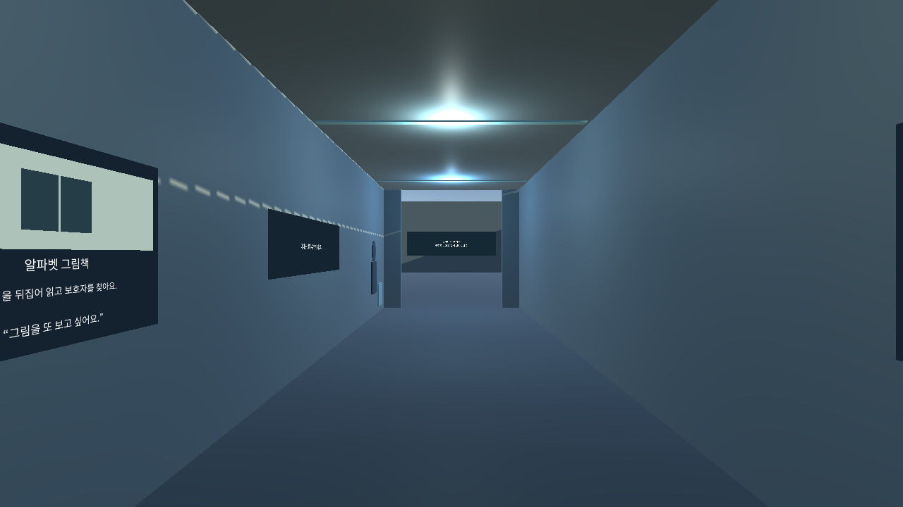

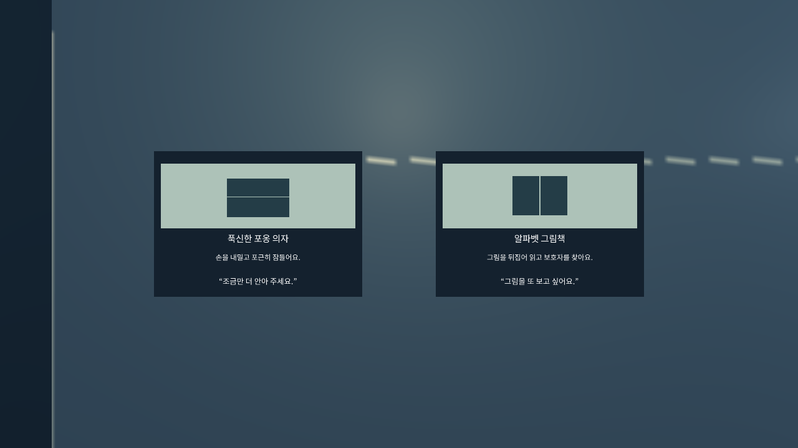

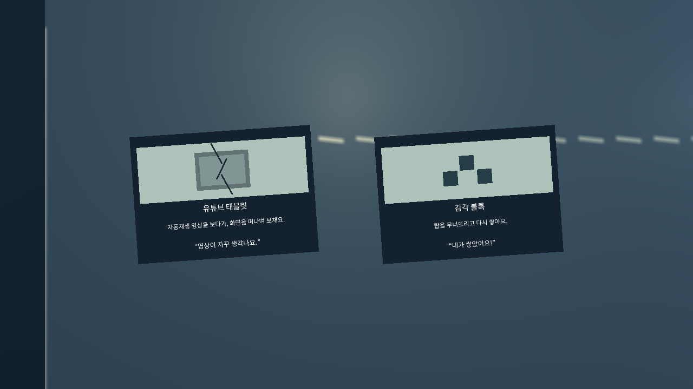

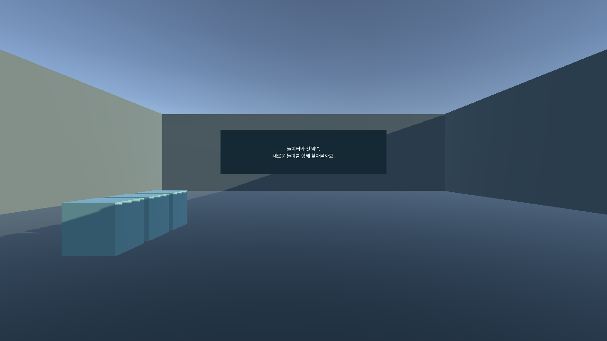

### 06 수정 내역

- 회상 비교 중 문이 열리면 `HeadToExit`가 초파리의 NavMesh 이동을 재개해 추가 방문이 생겼다. 지정된 방문 세트의 비교 검사에서만 문 개방 후 이동을 다시 멈췄다. 실제 게임의 자율 출구 이동은 유지한다.
- 접촉 방향은 아이에서 도구를 향하는 방향이다. 테스트가 반대로 전달해 가구 안쪽으로 밀던 문제를 고쳤으며, 가구에 막힌 밀기는 회피 흔적을 만들지 않는 별도 검사도 추가했다.
- 밀려난 경험의 기록을 지연될 수 있는 `OnTriggerExit`에 의존하지 않도록 바꿨다. `FlyAgent`가 실제 밀기 이동 직후 물품 영역과의 겹침을 검사해 이탈을 한 번 기록하고, 막힌 이동이나 자율 이동은 밀려남으로 분류하지 않는다.
- 이전 방을 숨겼을 때 복도 입구 측면으로 바깥 공간이 보이던 틈을 바닥과 같은 중첩 길이의 측벽·천장으로 막았다. 새 카메라 이동이나 흔들림 연출은 추가하지 않았다.
- Unity 6000.6의 `SceneHandle`을 정수로 암묵 변환하던 테스트 코드를 해당 타입 그대로 비교하도록 수정했다.

## 10. 07 반항·강제/반복 훈련·방향 순응

### 모델과 실제 방문 연결

`CoercionDetector`, `RepeatedTrainingTracker`, `ComplianceStateMachine`은 Unity 생명주기 없이 시간과 입력을 전달하는 C# 모델이다. `FlyContactReceiver`가 기존 두 접촉 소스와 공통 스트레스 계산을 유지하면서 이 모델들을 호출한다. `ItemSlot`은 실제 상호작용 영역에서 2초 체류가 완료된 순간 방문 맥락을 생성한다. 강요 여부를 먼저 기록하고 물품 효과·훈련 효과·체크포인트를 처리한 뒤 순응을 해제한다.

| 항목 | 적용 규칙 |
|---|---|
| R | 초기 0, 모든 변경은 `StatSystem.ApplyDelta`, 0~100 제한, 방 전환 후 유지 |
| 물품 | 최초 방문에만 일반 ±12 / ★ ±25, R도 `statDeltas`에 포함 |
| 휠체어 강제 훈련 | I 또는 H의 정의상 합산 증가가 +5 이상인 물품, 방문 전 10초의 해당 방향 접촉 → R+2/S+1 |
| 전기 봉 강제 훈련 | 해당 방향 전기 접촉이 하나라도 있으면 R+5/S+3, 약한 밀기 가산과 중복하지 않음 |
| 전기 접촉 자체 | 방문과 무관하게 접촉마다 기존 기본 스트레스 + S2. 순응 점수에서 제외되는 빠른 재접촉도 포함 |
| 반복 훈련 | 서로 다른 해당 물품의 3·4·5번째 첫 방문에 각각 R+4/S+3, 강제 훈련과 합산 |
| 지켜보기 | 도구 미사용 60초마다 R−2, 방당 감소 허용량 8, 기존 신뢰 타이머 공유 |
| 순응 진입 | S+4/R+6 한 번, 순응 중 추가 유효 접촉은 S+1/R+2 |

07 지시문의 반복 훈련 설명 중 “4번째, 5번째부터 더 늘지 않음”이라는 괄호는 “세 번째부터, 최대 3회”와 모순된다. 단일 기준인 스펙 4.5에 따라 **3·4·5번째에 적용하고 6번째부터 추가하지 않는다.** 재방문·효과 종료 후 방문은 추가 훈련을 발생시키지 않는다. 관찰 회복의 방별 허용량과 반복 훈련 카운터만 새 방에서 초기화하고 R 자체는 유지한다.

`coerced_training`, `repeated_training`, `compliance_enter`, `compliance_contact`, `rebellion_recovery`, `forced_visit` 로그를 구분한다. `item_first`/`item_revisit`에도 `forced`와 `complying`을 기록한다. 순응 중 재방문도 `forced_visit`을 남기고 순응을 해제하지만 물품·강제/반복 훈련 효과는 다시 적용하지 않는다. 06 회상 선정에 사용하는 `actualChangeMagnitude`는 기존 기준인 **물품 기본 효과의 실제 S/I/H/P/L 변화량**을 유지한다. R 및 별도 훈련 가산 때문에 같은 경험의 선정 기준이 바뀌지 않는다.

### 상태 전이

```text
Free ── 기존 연속 접촉 4회 ──> AvoidingTool (12초)
AvoidingTool ── 회피 시간 만료 ──> Free
Free / AvoidingTool ── 방향 점수 임계 도달 ──> Complying
Complying ── 같은 방향의 유효 접촉 ──> Complying (8초 갱신)
Complying ── 8초 만료 / 물품 방문 확정 ──> Free → 자율 이동
Complying ── 반대 방향 유효 접촉 ──> Free (새 방향 점수부터 집계)
```

최근 30초의 점수는 휠체어 1 / 전기 봉 2이며, 점수에 인정되는 접촉 사이는 최소 1초다. R<70은 6점, R≥70은 8점으로, R=100에서도 약한 밀기 8회 또는 전기 봉 4회면 순응한다. 순응 진입 시 기존 회피를 즉시 종료하고, 순응 중에는 접촉으로 회피가 다시 켜지지 않는다. 10초간 유효 접촉이 없거나 반대 방향으로 바뀌면 누적을 초기화한다. 빠른 재접촉은 기본 개입 집계·스트레스·감전 연출에는 계속 반영된다.

방문 완료 직후의 재접촉도 마지막 유효 접촉으로부터 1초가 지나야 새 점수로 센다. 새 방 진입 시에는 점수·방향·접촉 간격을 초기화한다. 순응 도중 문이 열리면 출구 이동 요청을 보관했다가 순응이 끝난 뒤 실행하므로 8초 방향 순응이 문 개방에 의해 덮어써지지 않는다.

### 조정 가능한 방향과 경로 값

이번 단계의 값은 모두 `GameBalanceConfig`와 기존 설정 에셋에 반영했다. 아직 설정하지 않았던 07 필드의 0을 실제 기본값으로 채웠으며, 01~06의 튜닝은 유지했다.

- **강제 유도 허용각 45도:** 접촉 당시 아이 위치→물품 방향과 `PushResolver`의 실제 밀림 방향을 비교한다. 아이→도구 방향을 반대로 사용하지 않는다. 물품 반대편이나 옆을 향한 전기 접촉은 강제 훈련의 강한 접촉으로 승격하지 않는다.
- **반대 방향 90도 이상:** 최초 누적 방향의 전방 반구를 벗어나면 새 누적을 시작한다. 180도 반전뿐 아니라 명확히 옆으로 바꾸는 입력도 이전 방향 점수를 잇지 않도록 한 선택이다.
- **순응 연장 허용각 45도:** 현재 순응 방향과 이 각도 이내일 때만 8초를 갱신한다. 그 밖의 반대가 아닌 유효 접촉은 추가 접촉 비용을 내지만 시간을 갱신하지 않는다. 각도는 플레이테스트로 조정할 수 있다.
- **탐색 거리 6m, 샘플 반경 0.5m:** 방향 범위 안의 가까운 물품에 도달 가능한 상호작용 지점이 있으면 그곳을 목표로 한다. 그렇지 않으면 앞쪽 6m를 검사하고 벽 앞 NavMesh 경계로 줄인다. 실패 시 거리 6단계·좌우 60도/6단계 후보를 탐색한다. 모든 후보는 완전한 NavMesh 경로를 요구한다. 점프나 순간이동 없이 `NavMeshAgent`가 이동하며, 완전히 갇혔다면 안전하게 멈추고 순응 시간 종료를 기다린다.

### 후속 방에서 사용할 플래그

`GameState.IsHighRebellionDialogue`는 현재 R≥35를 실시간으로 반영한다. `IsFlightSmokeEventEligible`은 현재 R≥60 여부다. 실제 특별 이벤트 확정은 스펙 5.4에 맞춰 **10번 청소년기 출구 개방 시 `CaptureAdolescenceExit(now)`를 한 번 호출**한다. 그 순간의 R, 확정 여부, 확정 여부를 이미 기록했는지를 저장 데이터에 보존한다. 이후 R이 오르거나 내려도 확정값은 변하지 않는다. 영유아 방에서 R이 60에 도달했다고 청소년기 이벤트를 미리 확정하지 않는다. 실제 비행·흡연 연출은 10번 범위다.

영유아 HUD에 반항 R을 추가했다. `03_RoomShellTest`와 `01_Infant`는 기존 접촉 어댑터에서 자동으로 새 모델을 생성하므로 씬 재생성이 필요 없다. 설정 에셋은 인스펙터에서 조정하고, 코드에서는 `FlyContactReceiver.Compliance`, `FlyAgent.IsComplying`으로 상태를 읽을 수 있다.

### 07 검증 결과

2026-11-23 전체 회귀 검사는 **EditMode 104/104, PlayMode 32/32**, 실패·생략 0개다. 07 추가 검사는 EditMode 24개, PlayMode 4개다. 결과는 `Logs/editmode-results.xml`, `Logs/playmode-results.xml`에 저장한다.

- 강제 훈련의 약한/강한 추가값, 방향·접촉 원점·10초 경계, 혼합 접촉의 강한 판정 우선, 최초 방문 1회 제한.
- 반복 훈련 3·4·5번째의 누적과 최대 3회, 강제 훈련과 합산, 비대상·효과 종료 물품 제외, 새 방 카운터 초기화.
- 일반/★ 물품의 R 포함 ±12/±25 제한, 관찰 회복의 60초 경계·방당 −8·접촉 시 타이머 재시작·신뢰 상한과 독립 동작.
- R=69.99/70/100의 순응 임계, 빠른 재접촉은 즉시 스트레스만 적용, 회피 중 임계 도달 시 즉시 순응, 반전·10초 유휴·30초 윈도·8초 연장/만료.
- 실제 씬에서 R=100 전기 봉 4회로 순응 후 방향 이동. 진입·추가·빠른 재접촉의 스트레스가 각각 64.35 → 68.5 → 71.9임을 확인하고 R=100 상한을 유지.
- 실제 슬롯 도착과 체류에 의해 강요한 첫 방문·재방문을 구분하고 I+5를 한 번만 적용. 첫 방문 R은 순응 +6 / 강제 훈련 +5 = 11, 순응 재방문 후에는 새 순응 +6만 더해 17.
- 벽을 향해 밀어도 완전한 대체 경로를 따라 실제로 이동하고 방 밖으로 나가지 않음. 문 개방은 순응 목표를 덮어쓰지 않고 해제 후 출구 이동으로 연결.
- R=35 대사 플래그, 청소년기 출구 R=59/60 판정, 확정값 저장/복원, 이후 R 변화로 확정값이 바뀌지 않음.

마지막 경계 검토에서는 방문 완료가 최소 접촉 간격을 우회하지 않도록 했고, **회피 중 방향 변경은 점수만 초기화**하도록 분리했다. 반대 방향 접촉 하나로 12초 회피가 취소되지 않으며, 새 방향으로 순응 임계에 도달해야 회피를 종료한다. 이 수정 후 전체 EditMode 104개와 관련 PlayMode 4개를 다시 실행해 통과했다. 관련 통합 재검증 결과는 `Logs/step07-playmode-results.xml`이다.

통합 검사에서는 접촉 누적 중 시작 위치를 고정하고, 순응 진입 후 실제 에이전트를 움직여 경로·체류·해제를 확인한다. HMD를 착용한 수동 접촉 시험은 수행하지 않았다. 아래는 테스트용 카메라로 촬영한 실제 `03_RoomShellTest`의 벽 앞 도착 화면이며, 애니메이션이나 최종 아트는 이번 단계의 범위가 아니다.

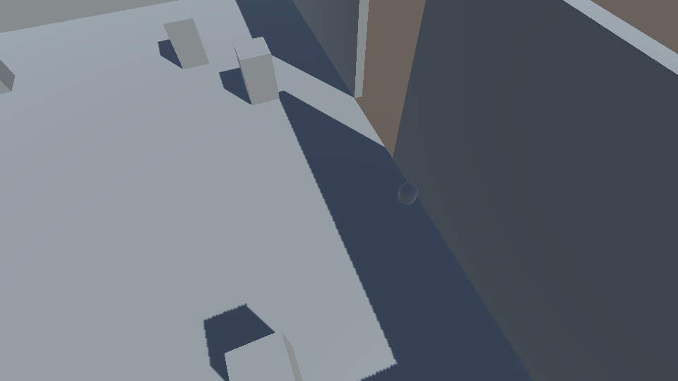

## 11. 08 태그 선호·회피 학습

### 기억과 학습 시점

`TagDefinitions`는 놀이·공부·휴식·운동·관계·성과·소비·창작·반항의 9개 태그를 정의한다. 기존 에셋과 회상 저장의 호환성을 위해 문자열 배열을 유지하며, 에디터 검증과 실제 물품 효과·선택 후보 생성 시 목록 밖의 태그를 거부한다. 중복 태그는 학습과 선택에서 한 번만 사용한다. 물품의 `baseAttraction`은 기존 9개 모두 0이다.

`GameState.Preferences`의 `PreferenceMemory`는 회차 단위다. 태그별 선호·회피는 0에서 시작하고, 방이 바뀌어도 유지하며 `tagMemory` 목록으로 저장·복원한다. 이전 저장처럼 기억 목록이 없으면 0으로 시작한다. 물품 ID는 학습 로그에만 남기고 다음 방의 판단에는 태그 기억을 사용한다.

| 학습 | 실제 적용 조건 | 기본값 |
|---|---|---|
| A: 저지 | 최근 6초 안의 밀기 이후 원래 자율 목적지와 다른 물품에 도착해 2초 방문 확정, 또는 상호작용 중인 물품 영역에서 실제 밀려남 | 휠체어 접촉당 회피 +0.3, 전기 봉 +0.6, 한 결과당 최대 +1.8 |
| B: 즐거움·피로 | 최초 방문 효과가 실제 적용될 때의 물품 기본 S/I/H/P/L 변화 | `utility = -ΔS + 0.5×(ΔI+ΔH+ΔP+ΔL)`; 선호 변화 `clamp(utility×0.05, -1, +1)` |

A는 접촉만으로 발생하지 않는다. 벽·가구에 막혀 영역에 남은 경우, 원래 물품에 그대로 도착한 경우, 6초를 넘긴 접촉, 이전 방의 미확정 접촉은 학습하지 않는다. 같은 결과를 영역 이탈과 후속 방문에서 중복 학습하지 않는다. 새 물품에 진입했더라도 2초 체류가 확정되기 전의 추가 접촉은 원래 자율 목적지를 계속 참조한다. 이미 방문이 확정된 영역에서 밀려나면 현재 상호작용 물품의 태그를 기록한다. 접촉 횟수·스트레스·접근 방향·원래 물품·결과 물품·결과 종류를 `EventLogEntry.learning`에 저장한다. 신뢰 비용은 기존 04 접촉 공식이 담당하며 학습에서 중복 차감하지 않는다.

B는 정의상의 보상이 아니라 0~100 제한을 거친 **실제 변화량**으로 계산한다. 이미 지능 100이라 +10이 적용되지 않았다면 그 +10으로 즐거움을 학습하지 않는다. 재방문, 효과 종료 후 방문, R만 변하는 경우, 효용 합계 0에서는 선호 변화가 없다. 강제·반복 훈련의 별도 비용과 순응 비용은 물품 기본 효용에 섞지 않는다. 강요된 방문도 실제 물품 경험에 따른 B는 받을 수 있고, 저지 경험에 따른 A는 별도다.

선호 기억은 ±10, 회피 기억은 0~1000으로 제한한다. 지나치게 큰 점수와 무한 누적을 막기 위한 구현 선택이며 모두 `GameBalanceConfig`에서 조정한다. 물품 효용은 스트레스 한 점을 성장·관계 합계 두 점과 같은 무게로 두었다. 예를 들어 학습 화면은 보상과 피로를 함께 학습하고, 그림책은 작은 긍정 경험으로 남는다. 생물학적 모델이 아닌 게임 밸런스 초안이다.

### 선택 확률과 이동 통합

`ItemChoiceModel`은 도달 가능한 후보에서 현재 목적지를 먼저 제외하고 다음 식을 적용한다. 남은 후보가 현재 물품 하나뿐인 경우만 기존 03 예외처럼 재선택한다. `FlyAgent`는 모든 후보의 완전한 NavMesh 경로를 확인한 뒤 선택 모델에 전달하고, 실제 이동에는 확인한 접근 지점을 사용한다. 기존 30초 체류 제한·07 순응·출구 이동은 유지한다.

```text
score = baseAttraction + average(tagPreference) - average(tagAvoidance)
        + stateNeed + randomNoise
softmax_i = exp(score_i - maxScore) / sum(exp(score_j - maxScore))
P_i = (1 - explorationFloor) × softmax_i + explorationFloor / N
```

태그 수만으로 편향이 배가되지 않도록 선호와 회피는 물품 태그들의 평균이다. 스트레스가 50~100이면 휴식 태그의 필요 점수가 0~1.5, 건강이 50~0이면 운동 태그의 필요 점수가 0~1로 증가한다. 그 외 상태 보정은 없다. 난수 잡음은 −0.1~+0.1이다. 최대 점수를 빼고 지수를 계산해 큰 점수에서도 오버플로를 피한다.

균등 탐색 혼합 비율은 영유아 **0.65**, 아동 **0.55**, 청소년 **0.45**, 청년 **0.35**이고 공통 하한은 0.35다. 영유아 첫 120초는 기억을 쌓되 선택에는 사용하지 않는 **100% 균등 탐색**이다. 아동기 이후에는 입장부터 이전 방의 태그 기억을 사용한다. 후속 방은 `RoomController.ConfigureLifeStage()`로 시기를 지정한다. 물품 이름이나 방 ID 문자열에서 시기를 추측하지 않는다.

예를 들어 후보 두 개의 점수가 0과 1이면 softmax는 **0.268941 / 0.731059**다. 청년기 탐색 비율 0.35를 섞으면 **0.349812 / 0.650188**가 된다. 회피 기억 1000으로 softmax가 수치적으로 0에 가까워져도, 일반 후보 N개에서 최종 확률은 최소 `explorationFloor/N`이다. 완전 접근 금지는 만들지 않는다. 문이 열린 이후의 출구는 기존 05의 3개 선택권을 유지하는 별도 후보로 취급하고, softmax와 균등 분포 모두 이 선택권 수를 반영한다. 출구만 허용되는 시간에는 출구만 남는다.

모든 난수는 기존 `RunSeed` 기반 난수 공급자를 통해 소비한다. 같은 시드·같은 사건·같은 후보 순서는 같은 선택열을 만든다. 이는 매 방문에 같은 물품을 고른다는 뜻이 아니다. 디버그 패널과 확률 조회는 난수를 소비하지 않는다. 저장은 태그 기억과 로그를 복원하며, 기존 저장 방식처럼 난수 생성기의 중간 상태까지 복원하는 기능은 추가하지 않았다.

### 재현 비교와 실제 학습 로그

시드 **808**, 서로 다른 아동기 후보 4개, 탐색 비율 0.55, 연속 같은 물품 금지 조건으로 각각 **20,000회** 선택했다. 비교군은 이전 영유아 놀이 물품에서 전기 봉으로 밀려난 확정 결과 12개를 학습해 놀이 회피가 약 7.2다. 시험은 게임 모델의 접촉→이탈 확인 경로를 호출하고, 다음 방에서는 다른 물품 ID를 사용한다. 실제 20,000번의 NavMesh 이동이나 HMD 플레이를 수행한 것은 아니다. 16번의 전체 통계 검증 전 분포 회귀 검사다.

| 아동기 물품 | 개입 없는 회차 | 이전 방에서 놀이 저지 |
|---|---:|---:|
| 새 놀이 물품 | 5,031 (25.16%) | 3,100 (15.50%) |
| 새 공부 물품 | 4,988 | 5,637 |
| 새 휴식 물품 | 5,006 | 5,666 |
| 새 운동 물품 | 4,975 | 5,597 |

개입 없는 회차를 같은 시드로 다시 실행하면 네 빈도가 정확히 재현된다. 두 회차 모두 모든 후보가 선택되고, 즉시 같은 물품을 반복하지 않는다. 원본 수치는 `Logs/preference-comparison.txt`에 저장한다.

이 분포 비교에서는 현재 스탯을 두 조건에서 동일하게 유지해 태그 기억의 영향만 분리했다. 실제 게임에서는 개입으로 달라진 스트레스와 건강도 상태 필요 점수를 통해 선택에 함께 작용한다.

실제 씬 검사에서 나온 학습 사례는 다음과 같다. A의 첫 접촉은 가구에 막혀 이탈하지 않아 그 시점에는 학습하지 않았으며, 두 번째 접촉 후 실제 이탈이 확인되어 최근 접촉 2개를 한 결과로 학습했다.

| 이벤트 | 물품·태그 | 실제 기록 |
|---|---|---|
| `learning_avoidance` | `slot_nc`, 놀이 | 접근 `(0,0,1)`, 접촉 2회, S≈54.8, 결과 `pushed_away`, 회피 +1.2 |
| `learning_preference` | 그림책, 공부 | S+3/I+8/L+2 → 효용 +2, 선호 +0.1, `enjoyment` |
| `learning_preference` | 조기학습 화면, 성과·공부 | S+9/I+11/H−2/L−2 → 효용 −5.5, 각 태그 선호 −0.275, `fatigue` |
| `learning_preference` | 포옹 의자, 휴식·관계 | S−7/H+3/L+8 → 효용 +12.5, 각 태그 선호 +0.625 |

실제 이탈 로그는 `Logs/preference-runtime-example.json`, 영유아 방의 실제 체류·최초 효과·저장 검사 결과는 `Logs/preference-infant-checkpoint.json`에 있다. 영유아 물품 9개의 B 학습이 최초 방문마다 한 번만 기록되고 태그 기억이 체크포인트에 들어가는 것을 함께 검사한다.

### 디버그 패널과 빌드 경계

에디터/개발 빌드에서 **F8**로 패널을 켜거나 끈다. 기본값은 꺼짐이다. 현재 목적지, 마지막 선택, 시드, 탐색 비율, 후보별 기본 매력·선호·회피·상태 필요·난수·총점·최종 확률을 표시한다. 패널은 카메라 자식 World Space Canvas여서 VR에서도 양안으로 볼 수 있으며, 업데이트는 실제 시간 0.25초 간격이다. 영문 물품 ID를 사용하는 개발용 표시다. 플레이어용 영유아 HUD와는 별개다.

`UNITY_EDITOR || DEVELOPMENT_BUILD` 조건에서만 자동 생성한다. 릴리즈에서는 강제로 `SetVisible(true)`를 호출해도 UI를 만들지 않는다. 15번 체크리스트에 Development Build를 끈 Quest 플레이어에서 F8 표시가 비활성인지 재검증할 항목을 추가했다.

F8 입력 자동 검사의 최초 실패는 배치 에디터에서 키보드가 Game View로 전달되지 않은 경우였다. 검사 동안만 Input System의 에디터 입력 전달/백그라운드 설정을 변경하고 종료 시 원복한다. 실제 게임의 입력 설정은 바꾸지 않았다.

Windows Standalone 개발/릴리즈 플레이어를 각각 빌드하고 실제로 실행해 다음을 확인했다. 두 실행 모두 에디터 밖에서 종료 코드 0을 반환했다.

| 플레이어 | 자동 HUD 부착 | 표시 강제 요청 후 UI | 시드·후보 표시 |
|---|---|---|---|
| Development | 예 | 표시 | 정상 |
| Release | 아니오 | 생성·표시 안 됨 | 빈 문자열 |

재현 명령은 Unity 배치 `-executeMethod FruitFlyParenting.Editor.PreferenceBuildVerification.BuildVariants`다. 작성된 씬을 수정하지 않고 검사 전용 복사 씬과 `PREFERENCE_VERIFICATION` 심볼을 사용한다. 복사 씬은 빌드 후 제거하고, `PreferenceBuildProbe`는 일반 플레이어 빌드에 포함되지 않는다. 빌드 출력은 Git 제외 대상인 `Builds/Step08Development`, `Builds/Step08Release`에 있다. 플레이어에 `-preferenceVerificationPath <결과 JSON 절대 경로>`를 전달하면 검증 후 종료한다. 결과 파일은 `Logs/preference-player-development.json`, `Logs/preference-player-release.json`이며 개발 플레이어의 실제 렌더링도 캡처했다. Quest 기기 검증은 15번에 남아 있다.

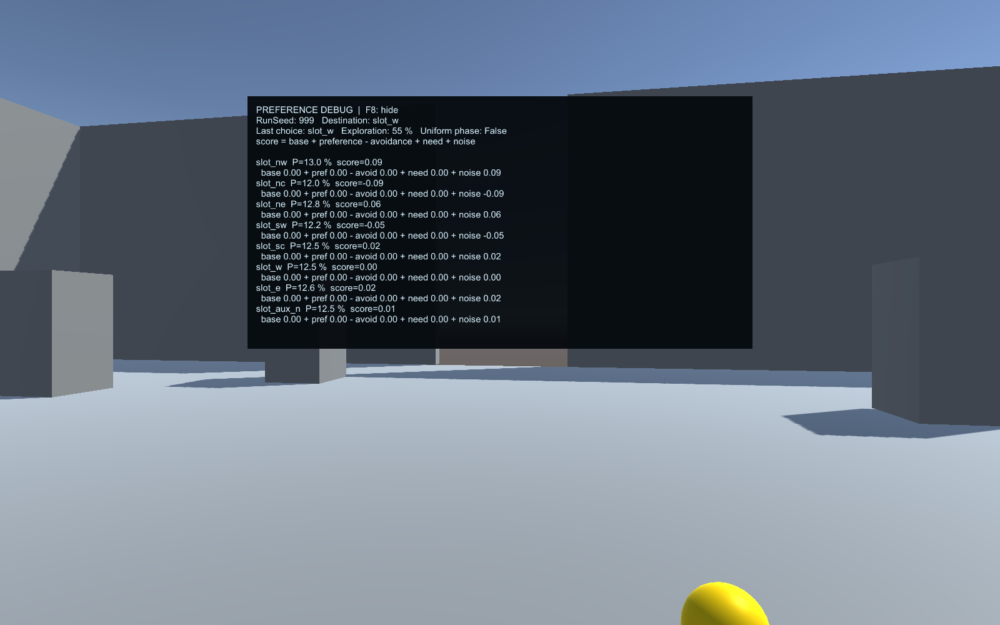

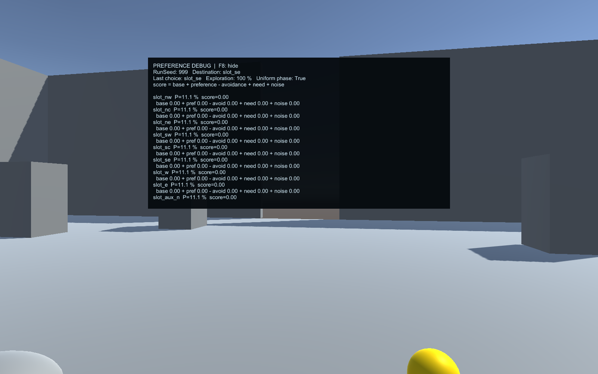

### 08 최종 검증

2026-11-23 전체 **EditMode 125/125, PlayMode 36/36** 통과, 실패·생략 0개다. 08 추가 모델 검사는 21개, 씬 통합 검사는 4개이며 기존 영유아 9개 물품 검사에도 학습 로그 9개와 태그 기억의 체크포인트 저장 확인을 추가했다.

- 회피 1000의 비제로 확률, 동일 점수 균등 분포, 큰 점수의 안정적인 softmax, 시기별 설정값·상태 필요·도달 가능 후보 필터.
- 6초 경계, 같은 목적지·무접촉·시간 초과·방 전환 제외, 실제 이탈 한 번만 학습, 다른 물품 방문 전 추가 접촉에서도 원래 목적지 유지.
- 실제 적용된 보상·피로와 스탯 상한, R 제외, 재방문·효과 종료 후 중복 학습 방지, 저장 후 태그 일반화.
- 동일 시드 비교·재현성과 선택 다양성, 디버그 조회가 난수 흐름에 영향을 주지 않음.
- 저장된 씬의 실제 이동·체류·이탈·벽에 막힌 접촉, F8 표시/숨김, GPU 캡처.
- Windows 개발/릴리즈 빌드 성공과 별도 실행 성공. 빌드 도구는 URP/OpenXR 전처리기가 갱신하는 설정 파일도 검사 전 값으로 복원한다.

결과 XML은 `Logs/editmode-results.xml`, `Logs/playmode-results.xml`에 있다. 학습량·상태 필요 보정은 이번 단계의 명시적 초안이며 실제 HMD 체감 튜닝과 여러 시드의 장기 플레이 분포는 후속 단계에서 확인한다.

## 12. 09 아동기 방 — 놀이터와 첫 약속

### 씬과 배치

`01_Infant`에서 복도 1을 지나면 실제 아동기 방이 시작된다. 아동기 방은 로컬 24×22m의 `RoomShell`을 재사용하며 월드 원점은 `(38,0,0)`이다. 복도 2는 x=62~76m, 다음 청소년기 임시 공간은 x=76m부터다. 직접 검사할 때는 `03_Childhood`를 연다. 이 씬의 아동기 방 원점은 `(0,0,0)`이며 기본 빌드 시작 씬은 계속 `01_Infant`다.

교실(x=0~12)은 갈색 바닥·책장 벽화, 놀이터(x=12~24)는 초록 바닥·하늘 벽화·보조 조명으로 구분한다. 바닥 경계에는 충돌체나 칸막이가 없다. `ChildhoodNavMesh.asset`은 기존 쉘의 9개 가구를 12개로 교체한 뒤 다시 베이크한 공유 에셋이다. 티셔츠·반바지·프로펠러 모자를 입은 아동기 캐릭터는 입장 시 활성화된다. 복도에서 다음 방을 준비하는 동안에는 아동기 시계와 방문 효과가 시작되지 않는다.

아래 좌표는 방 로컬 `(x,z)`이며 수치 순서는 **S/I/H/P/L**이다. `ChildhoodCatalog`와 생성된 12개 `ItemDefinition`에 반영했다.

| 물품 | 좌표 | 기본 효과 | T | R |
|---|---|---|---:|---:|
| 경시대회 책상 | (5,17) | +10/+12/−2/+2/0 | 0 | 0 |
| 만들기 책상 | (12,18) | +1/+7/+1/+2/+3 | 0 | 0 |
| 축구 골대 | (19,17) | +1/0/+10/+5/+2 | 0 | 0 |
| 도서관 쿠션 | (5,5) | −3/+6/0/0/+1 | 0 | 0 |
| 친구의 생일상 | (12,4) | −2/+1/0/+9/+5 | 0 | 0 |
| 오락기 | (19,5) | −5/+1/−2/+3/+1 | 0 | 0 |
| 동네 산책길 | (21,14) | −6/+1/+7/0/+2 | 0 | 0 |
| 가족 식탁 | (3,14) | −5/0/+2/0/+8 | 0 | 0 |
| 전국 영재 선발 시험장 ★ | (8,20) | +20/+23/−9/+7/−7 | −4 | 0 |
| 어린이 스타 촬영장 ★ | (16,20) | +17/+2/−13/+22/−8 | −4 | 0 |
| 숙제 찢기와 비밀 아지트 ★ | (8,2) | −16/−11/+4/+8/−7 | −5 | +15 |
| 몰래 밤새는 게임방 ★ | (16,2) | −18/−9/−17/+11/−5 | −4 | +12 |

동·서 슬롯은 문축에서 3m 떨어진 기존 03의 z=14를 유지했다. 스펙에 숫자가 없는 북상/남하 네 슬롯은 외곽 행의 `(8,20)/(16,20)/(8,2)/(16,2)`로 보완했다. 2.5m 정사각형 경고 영역끼리 겹치지 않으며 1m 실제 가구와 외벽 사이에 최소 1.5m를 남긴다. 만들기·생일상은 경계 x=12에 있다. 보완 근거는 `ChildhoodCatalog.cs`에도 주석으로 남겼다.

### 방문·망설임·학습

일반 물품은 기존 2초 체류, ★ 물품은 **2초 망설임 후 2초 체류**로 확정한다. 망설임 중에는 NavMeshAgent를 멈추고 외형만 작게 기울이며 자율 선택 목적지를 바꾸지 않는다. 카메라는 흔들지 않는다. 기존 도구의 물리 밀기는 허용하고 영역을 떠나면 망설임과 체류를 다시 시작한다. 재방문도 연출은 재생하지만 최초 효과와 T/R 비용을 다시 적용하지 않는다.

일반 ±12 / ★ ±25 제한은 기존 `ItemEffectApplier`의 같은 경로를 사용한다. 07의 강제·반복 훈련과 08의 태그 학습은 계속 작동하며 위 표는 그 추가 비용을 포함하지 않은 물품 기본값이다. 예를 들어 표 순서로 12개를 모두 한 번씩 방문하면 축구·도서관·산책에서 반복 훈련이 세 번 발생해 R+12/S+9가 별도로 더해진다. 관찰 회복이 발생하기 전 테스트에서 최종 **R=39, T=33**이고 아지트·밤샘 게임 재방문 후에도 그대로다. 새 방에서 스탯과 태그 기억을 초기화하지 않는다.

### 종이비행기 사건과 복도 2

발생 시점은 기본 문 개방 480초의 **0.4375배=210초(3분 30초)**로 정했다. 초반 90초 관찰 이후 여러 활동을 경험하면서도 출구 이전에 사건을 볼 수 있는 시점이다. 비율·신뢰 경계·6초 장면 길이는 `GameBalanceConfig`로 조정한다.

| 사건 시점의 기록 | 결과 |
|---|---|
| 만들기 또는 생일상 방문 | 사과하고 종이비행기를 함께 수리 |
| 위 조건 없음 + 아지트 방문 + T<40 | 사과를 미루고 찢어진 날개를 남김 |
| 그 외 (T=40 포함) | 종이비행기를 내려놓고 다음 날 대화를 약속 |

수리 분기가 우선한다. 사건 순간의 방문과 T를 한 번 판정하고 이후 방문으로 결과를 바꾸지 않는다. 사건은 추가 스탯·신뢰 효과를 주지 않는다. `childhoodAirplaneOutcome`, `childhoodAirplaneTrust`, `paper_airplane` 로그와 체크포인트로 결과를 보존한다. 종이 장난감 사건은 청소년기의 **비행기록**과 무관하며, 절도·비행·흡연 플래그를 확정하지 않는다.

복도 2는 기존 회상 카드 3개에 종이비행기 상태와 짧은 아이 대사를 추가한다. 이번 방에서 실제 `item_pushed_away`가 있었을 때만 중단된 놀이를 언급한다. 단순 접촉이나 이전 방의 밀림을 중단된 아동기 활동으로 만들지 않는다. 아동기 배경음은 복도 1의 재생 중인 소스를 이어받아 중복 재생 없이 복도 2의 청소년기 음원으로 전환한다.

### 종료 Stress와 다음 단계

`RoomTransitionController`가 **실제 출구 통과 후 복도에 진입하는 시점**에 `CaptureRoomExitStress`를 호출한다. 문 개방 시점의 값으로 미리 고정하지 않는다. 영유아 종료 S와 아동기 종료 S, 각각의 기록 여부를 저장하고 중복 호출은 무시한다. 두 기록이 모두 있을 때만 `IsPressureOutfitEligible`을 계산한다.

```text
(영유아 종료 S ≥ 70 AND 아동기 종료 S ≥ 70)
OR (두 종료 S의 평균 ≥ 75)
```

경계 검사: 70/70→참, 69/81→참, 69/80→거짓, 100/49→거짓. 기록 하나만 있으면 거짓이다. 실제 복도 2 운전 검사에서는 **영유아 80 / 아동기 72**가 체크포인트와 다음 방 진입 이후에도 유지된다. 조건용 집계까지 이번 단계이며 의상 적용과 청소년기 게임플레이는 10번 범위다.

### 재현과 검증 자료

2026-11-23 전체 **EditMode 148/148, PlayMode 43/43** 통과, 실패·생략 0개다. 이번 단계의 추가 검사는 모델 23개, 씬 통합 7개다. 아동기 NavMesh의 **148개 삼각형 모두 도달 가능**하며 별도의 가구 상단 섬 없이 한 바닥 영역으로 연결된다. 12개 물품 접근과 실제 x=6→18 경계 횡단도 통과했다. 결과는 `Logs/editmode-results.xml`, `Logs/playmode-results.xml`, `Logs/childhood-navmesh.txt`에 있다.

연속 플레이 검사는 준비 중에는 아동기 시계·캐릭터가 멈춰 있고 입장 후에만 시작하는지, 재생 중인 배경음을 이어받는지, 영유아 종료 S만 먼저 기록되는지도 확인한다. 이 검사에서 발견한 Unity 오브젝트의 null 판정 문제는 `AudioEchoFilter`를 Unity 방식으로 검사하고 없을 때 추가하도록 수정했다. 테스트 종료 후 다음 방의 활성 컨트롤러도 제거해 이후 검사를 오염시키지 않는다.

테스트 정리 코드 보완 후 복도·자율 이동 관련 **8/8**을 재실행해 통과했다(`Logs/step09-transition-results.xml`).

재생성 메뉴는 `Fruit Fly Parenting > Setup 09 Childhood Room`, 배치 메서드는 `FruitFlyParenting.Editor.ChildhoodRoomSetup.Build`다. 기존 영유아 빌더도 아동기 방을 붙이므로 영유아 씬을 다시 생성해도 임시 공간으로 돌아가지 않는다. 12개 물품 및 NavMesh 에셋은 기존 GUID를 유지한다.

`ChildhoodRoomModelTests`는 12개 에셋의 정확한 최초 효과·중복 방지, T/R, 사건의 시간·신뢰 경계와 우선순위, 저장 복원, 종료 S 조건, 망설임·체류, 배치 영역을 검사한다. `ChildhoodRoomIntegrationTests`는 저장된 씬의 실제 접근·체류·방문, 경계 횡단, 망설임 중 밀기, 사건 세 분기, 복도 2 운전과 저장을 검사한다. 기존 일반/★ 제한 검사와 02~08 회귀 검사도 함께 실행한다.

원본 기록은 `Logs/childhood-all-visits.json`, `Logs/childhood-exit.json`, 화면은 `Logs/childhood-overview.png`, `Logs/childhood-airplane-*.png`, `Logs/childhood-corridor-two.png`다. `Logs/`는 Git에서 제외하며 검토용 화면은 `docs/images/`에 보관한다. 세 사건 조건은 자동 플레이에서 실제 슬롯 방문으로 유도했으며 HMD를 착용한 수동 세 분기 검사는 아직 수행하지 않았다. OpenXR 런타임과 HMD가 없는 현재 환경의 제한은 이전 단계와 같다.

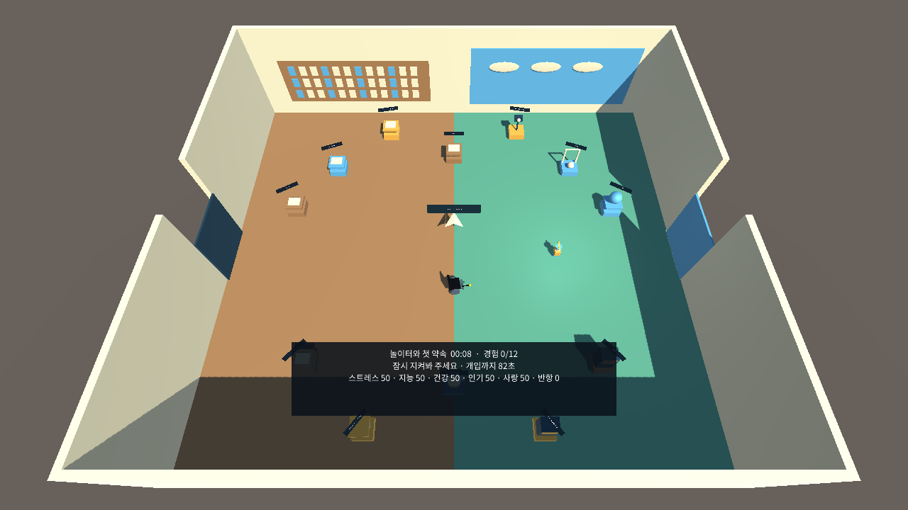

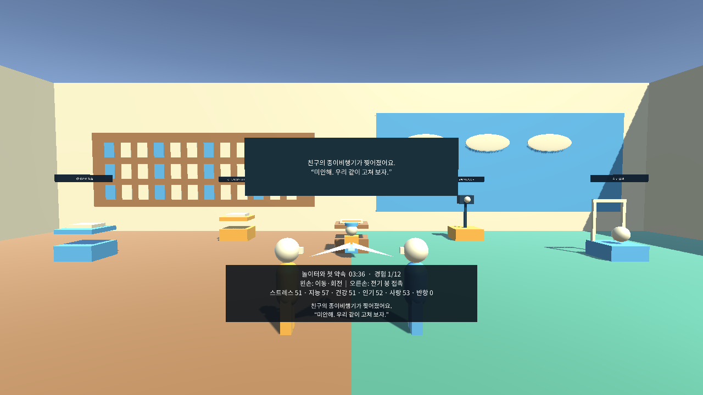

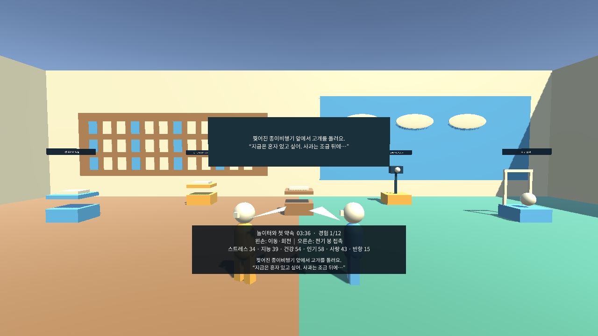

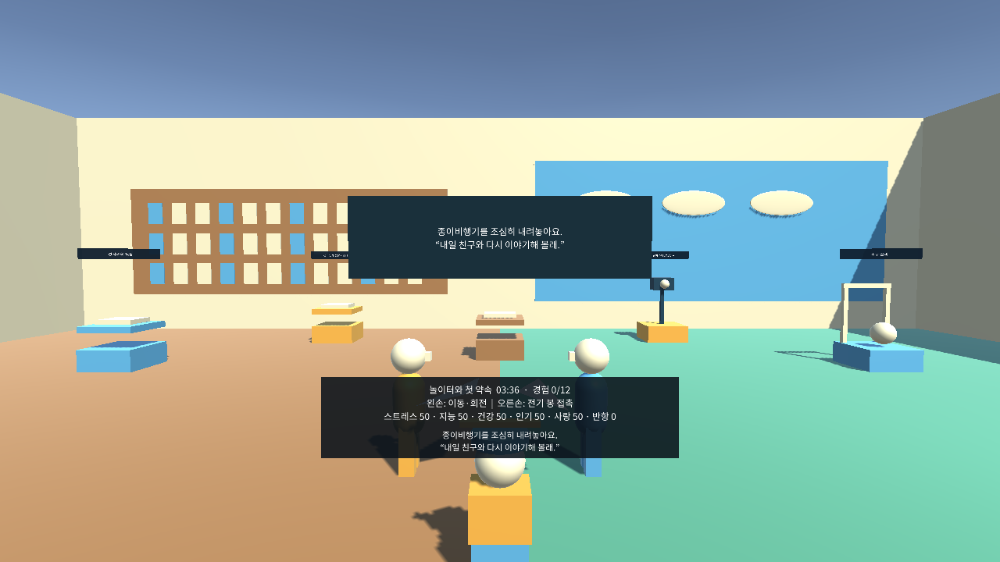

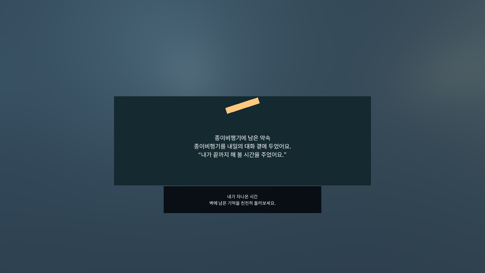
