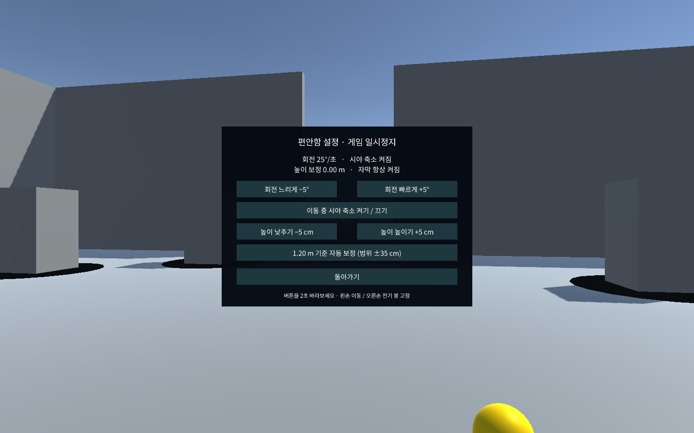
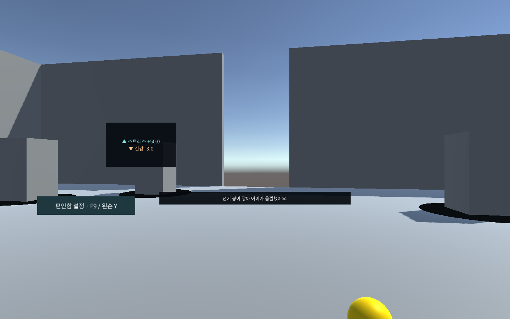

# 14단계 VR 편안함·접근성 감사

대상: 스펙 8장, 본편 `00_Bootstrap`, `01_Infant`, `03_RoomShellTest`, `03_Childhood`, `04_Adolescence`, `05_YoungAdult`, `06_MiddleAge`. 독립 ConnectomeViewer는 데스크톱 실험이며 본편 이동 규칙의 대상이 아니다. 씬에 복제된 객체까지 포함해 휠체어 **7개**, ItemSlot **133개**를 검사한다.

## 스펙 8장 체크리스트

| 항목 | 구현·감사 결과 | 근거 코드/씬 |
| --- | --- | --- |
| 왼손 휠체어 이동, 오른손 전기 봉 | 왼손 스틱만 ContinuousMove/Turn에 전달. 머리 방향은 이동 방향이 아니며 오른손 입력은 이동에서 Unused. 손 역할 전환은 제공하지 않음 | `WheelchairLocomotion`, `LoveStickTool`, `WheelchairRig.prefab`, 본편 7개 씬 |
| 입력 없는 정지 | 전진·회전 각 축이 데드존에 들어오면 같은 프레임에 속도 0. 차체의 중력 이동도 끔 | `WheelchairMotionModel.Step`, `WheelchairLocomotion.OnEnable` |
| 대체 이동 경로 없음 | 본편에 장착된 provider는 ContinuousMove/ContinuousTurn뿐. 시선 버튼은 설정·엔딩 선택만 수행하고 차체 위치를 변경하지 않음 | `ComfortAuditTests.EveryMainSceneHasSettingsAndFeedbackAndOnlyContinuousProviders`, `GazeAction` |
| 강제 카메라 이동·흔들림 없음 | 스토리 연출은 초파리·소품만 움직임. 휠체어 회전은 사용자 입력. 높이 보정은 아래에 명시한 사용자 요청 예외 | `AdolescenceExitSequence`, `GamblingMontage`, `PrologueController`, `ComfortController` |
| 전환 페이드 ≥0.5초 | 방/복도 기본 0.75초, 모델 최솟값 0.5초. 프롤로그도 같은 최솟값 적용. 높이 보정은 out/in 각각 실제 시간 0.5초 | `RoomTransitionSequence`, `PrologueController.EnterInfant`, `ComfortController.ApplyHeight` |
| 회전 속도·비네팅·높이 설정 | 게임을 일시정지하는 공간 고정 시선 메뉴. 저장된 설정을 각 씬의 리그가 적용. 자막은 항상 켜짐 | `ComfortController`, `ComfortPreferences`, 전체 씬과 리그 프리팹 |
| 대사·사건 자막 | 방 대사/내레이션·종이비행기·도박·편지·엔딩은 기존 텍스트 유지. 감전, 망설임, 창가 흡연, 담배 끄기 자막 추가 | `InfantRoomView`, `TransitionView`, `PaperAirplaneView`, `GamblingMontage`, `EndingPresentation`, `FlyShockFeedback`, `FlyHesitationFeedback`, `AdolescenceExitSequence` |
| 색 외에 모양으로 수치 표현 | clamp 후 실제 변화량을 ▲/▼와 +/- 숫자, 청록/주황으로 표시. 공개 S/I/H/P/L/R만 표시하며 숨겨진 T는 공개하지 않음 | `ComfortController.StatChanged/FormatDelta`, `StatSystem.OnStatChanged` |
| 개입 흔적의 모양 | 사진의 정적 기울기·균열, 부모 사진 비율, 그림자 사이 거리, 종이비행기 날개 기울기·텍스트 유지 | `CorridorRecapController` |
| 진입 전 그림자·소리 | 아이가 슬롯 반경 +1.5m 이내에 접근하면 바닥 표시와 조용한 공간 음향. 영역을 벗어나야 소리 재무장 | `ItemApproachFeedback`, 133개 슬롯의 컴포넌트 검사 |
| 최초 방문 뒤 조명 감소 | 방문 기록에 따라 물품 표시등 0.65→0.12, 바닥 표시도 어두워짐. 새 회차의 방문 리셋에 따라 복구 | `ItemApproachFeedback.RefreshVisuals`, `RoomController.VisitedItemIds` |
| 수치 팝업의 중앙 회피 | 카메라 기준 (-0.62, +0.08, 1.5)m, 폭 0.38m의 왼쪽 패널. 중앙 x=0을 덮지 않음. 자막과 설정 버튼 위치 분리 | `ComfortController.BuildUI`, GPU 캡처 |
| 시기별 소리·복도 메아리 | 서로 다른 리듬·음색의 자체 합성 루프와 기존 1초 크로스페이드·이전 소리의 echo 유지. 전환 경로마다 올바른 앞/뒤 클립 연결 | `tools/generate_comfort_audio.py`, `ComfortSetup`, `CorridorAudioController`, `CorridorAudioMix` |
| 게임 체크포인트 | 방 진입·최초 방문·복도 시작·엔딩 확정 저장과 시드/이벤트 로그 보존. 접근성 변경은 게임 수치나 확률을 수정하지 않음 | 기존 `SaveSystem`, 각 방 컨트롤러, `RoomTransitionController`, `MiddleAgeRoomController` |
| 플레이어 설정 영속성 | 별도 PlayerPrefs JSON 키에 즉시 Save. 회차 리셋과 독립. 버전·범위·손상 데이터를 검사 | `ComfortPreferences`, 프로세스를 나누는 `ComfortVerification` |

## 발견하고 수정한 항목

1. 스틱 해제 후 감속 중 전진/회전이 남던 동작을 수정했다. 가속과 반대 방향 입력의 감속은 유지하며 중립 입력에서는 즉시 정지한다.
2. 회전·비네팅·높이 설정과 설정 저장 UI가 없어 추가했다. F9, 왼손 Y/secondaryButton 또는 휠체어의 설정 버튼을 2초 바라보면 연다. 설정 창은 열리는 순간의 공간에 고정되어 고개를 움직여 항목을 선택할 수 있다. 일시정지 중에는 엔딩 등 다른 시선 버튼이 실행되지 않는다.
3. 높이 보정 시 추적 카메라의 로컬 pose를 덮어쓰지 않는다. XR Origin 하위 리그의 수직 오프셋만 암전에서 바꾸며 손과 머리를 함께 보정한다. 차체의 위치·yaw는 그대로다. 헤드셋 추적이 없으면 자동 보정을 실행하지 않고 안내한다.
4. 감전·망설임 효과와 흡연/소화 장면의 단계 변화에 자막을 추가했다. 숫자 변화 팝업도 실제 변화량 + 화살표를 사용한다.
5. ItemSlot의 일반 접근 피드백·첫 방문 조명 감소가 빠져 있어 전수 적용했다. NavMesh/가구 충돌체는 변경하지 않는다. 생성한 바닥 표시는 Collider를 제거한다.
6. 기존 배경음이 같은 파형의 주파수 변경에 머물러 있어 시기별 리듬·음색을 구분했다. 프롤로그→영유아기의 잘못된 다음 클립도 수정했다.
7. 프롤로그의 페이드에 0.5초 최솟값을 추가했다. 암전과 비네팅에는 XR stereo/instancing을 지원하는 `ComfortOverlay.shader`를 사용해 가까운 손·봉이 암전을 뚫고 보이지 않게 한다.

## 설정 기본값과 선택 근거

| 설정 | 기본값 / 범위 | 근거 |
| --- | --- | --- |
| 최대 이동 속도 | 기존 0.8 m/s | 기존 저속 휠체어 설정 유지 |
| 가속 / 반대 입력 감속 | 기존 0.6 / 1.2 m/s² | 기존 제한 유지. 중립에서는 즉시 정지 |
| 회전 속도 | 30°/초, 10~45°/초, 5° 단위 | 기존 기본값 유지, 더 느린 선택 제공. snap turn 없음 |
| 비네팅 | 기본 켜짐, 꺼짐 선택 가능 | 실제 이동/회전 중 주변부만 축소. 최대 불투명도 0.65, 중앙 투명 |
| 높이 | 기존 Device-origin 기준 1.20m + 저장 오프셋 0m | 기본 리그 높이 유지. 수동 ±5cm, 오프셋 범위 ±35cm |
| 자동 높이 보정 | 사용자가 누를 때 현재 추적 눈높이→1.20m 목표, ±35cm 제한 | 앉은 자세 편차 보정. 보정은 out/in 각각 0.5초 암전 중 적용 |
| 자막 | 항상 켜짐 | 음성·효과음을 듣지 못해도 사건을 알 수 있게 유지 |

기본값은 기존 저속 설정을 출발점으로 잡았다. 실제 타깃 기기에서 문자 크기·시야 가림·보정 범위를 확인하고 조정한다.

## 검색에서 구분한 예외

- `Assets/Samples/XR Interaction Toolkit/3.7.0/Starter Assets/`의 미사용 예제에는 Teleport/SnapTurn 관련 클래스·프리팹·입력 액션 이름이 남아 있다. 본편의 XROrigin은 별도 제작한 프리팹이며 그 이동 컴포넌트를 장착하지 않는다. 서드파티 샘플의 존재를 본편 실행 경로로 세지 않으며, 이를 이유로 패키지 샘플을 임의 삭제하지 않았다.
- `Assets/_Project/Experimental/Connectome/`의 카메라는 13단계 데스크톱 실험의 수동 회전·확대·초기화다. 본편 씬과 빌드에서 제외된다.
- HMD의 `TrackedPoseDriver`는 실제 머리 움직임을 반영한다. 높이 보정은 명시적 사용자 요청에 의한 수직 조정이다. 둘 다 강제 스토리 카메라 연출이 아니다.
- 프롤로그의 새 씬 로드와 엔딩의 새 회차 시작은 초기 리그 배치를 만든다. 진행 중인 방/복도에서는 휠체어 좌표를 순간이동시키지 않는다.

## 사운드 재현

`python tools/generate_comfort_audio.py`로 외부 음원 없이 PCM mono/16-bit/22050Hz WAV를 다시 만든다. 영유아는 완만한 음계, 아동은 장난감 타격음과 새소리 모티브, 청소년은 바람과 교실 종 모티브, 청년은 생활 타격음·낮은 환경음, 중년은 느린 음과 환경음이다. 실제 현장 녹음 또는 완성 음악으로 표시하지 않는다. 접근음은 0.3초, 배경음은 8초이며 루프 경계의 진폭을 0으로 만든다. [해시·RMS·피크](reports/step14-audio.json)를 기록한다. 실제 HMD 청취 평가는 남아 있다.

## 검증 환경과 남은 수동 확인

현재 작업 폴더의 사용자 Meta XR 209 변경은 보존한다. 앞 단계에서 확인된 MRUK 네이티브 초기화 종료와 Hand Tracking Subsystem 미설정 때문에, 자동 실행 검증은 `Logs/Step14Project`의 12단계 패키지/설정 기준 + 13/14단계 코드·자산 복사본에서 수행한다. 현재 사용자 XR 설정의 실기기 실행 성공을 주장하지 않는다.

자동 검증 결과는 [검증 JSON](reports/step14-validation.json)에 기록한다.

- [x] 이동: 전체 provider 구성, 왼손 전용 입력, 중립 즉시 정지, 벽 충돌과 기존 경로 회귀
- [x] 편안함: 공간 고정 설정 메뉴, 회전·비네팅, 암전 중 수직 보정, 가까운 물체까지 가리는 암전 GPU 검사
- [x] 피드백: 접근 영역 소리 재무장, 첫 방문 조명 감소, 실제 clamp 변화량의 색/모양 표시, 감전·망설임 자막
- [x] 소리: 시기별 클립과 경로 연결, 클리핑 없는 서로 다른 합성 파형, 기존 크로스페이드 회귀. 실제 HMD 청취는 아래 수동 항목
- [x] 저장: PlayerPrefs 값 검증, 씬 재로드/새 회차와 독립, 프로세스 재실행 후 디스크 저장 읽기

전체 EditMode **250/250**, 전체 PlayMode **67/67**이 통과했다. 이후 자막 겹침·암전 셰이더·망설임 자막의 최종 변경은 해당 PlayMode **6/6**으로 다시 검증했다. 마지막 6개를 전체 67개와 합산해 서로 다른 73개 검사로 표현하지 않는다. 원본 로그는 `Logs/Step14Project/Logs/editmode-results.xml`, `playmode-results.xml`, `step14-final-comfort.xml`이다.

Windows 빌드에 편안함 셰이더가 포함되고 13단계 실험 자산은 0개임을 BuildReport로 확인했다. 서로 다른 두 Unity 프로세스에서 임시 검증 키에 회전 35°/초·비네팅 off·높이 +0.15m를 저장/로드한 뒤 그 키만 삭제했다. 사용자 설정 키는 건드리지 않는다. 빌드는 `Logs/Step14Project/Builds/Step14/FruitFlyParenting.exe`에 있다.

- [ ] 실제 HMD에서 양안 비네팅·암전·글자 가독성 확인
- [ ] 사용자 신장과 기기 tracking origin에 따른 앉은 높이 보정 확인
- [ ] 실제 스틱에서 정지·회전의 편안함 및 시기별 배경음 청취 확인
- [ ] 사용자 Meta XR 설정을 완성한 뒤 해당 설정에서도 전체 VR 완주

씬을 이전 단계 Setup으로 다시 생성했다면 `Fruit Fly Parenting/Setup 14 Comfort and Accessibility`를 다시 실행해 접근성 컴포넌트를 적용한다. 재생성은 본편 빌드 씬 목록이나 사용자 XR 프로젝트 설정을 바꾸지 않는다.
